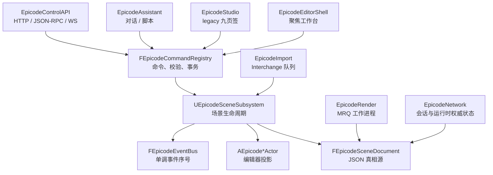
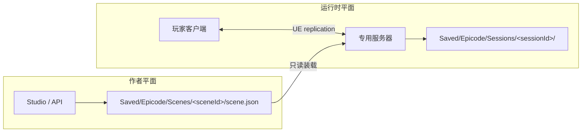
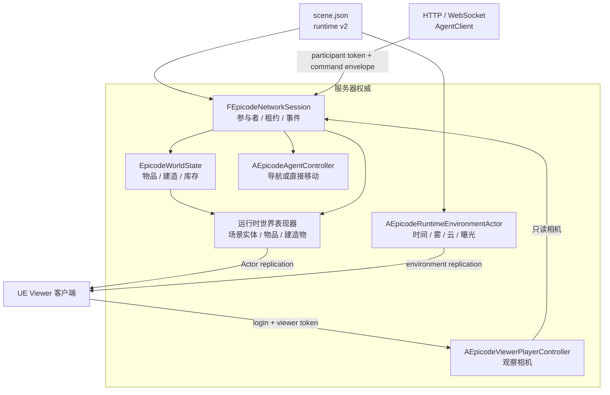

# Epicode 架构

## 目标

在 Unreal Engine 5.8 编辑器内提供可脚本化的视频制作工作流：管理场景、角色、道具、灯光、环境和相机，导入外部资产，并通过 HTTP/WebSocket 驱动，最终用 Movie Render Pipeline 输出帧序列或 MP4。

## 分层

十个插件：

- `EpicodeCore`：类型、场景文档、场景库、Actor、环境、相机、命令注册表、事件总线、设置、诊断。
- `EpicodeImport`：格式分类、Interchange 导入、任务队列、导入命令。
- `EpicodeControlAPI`：HTTP 服务、JSON-RPC、批量、幂等、鉴权、自定义 WebSocket 服务。
- `EpicodeStudio`：九个页签，覆盖场景、Outliner、角色、道具、灯光、环境、导入、渲染和 API。
- `EpicodeEditorShell`：默认聚焦工作台，负责自绘窗口、Epicode 菜单、视口、对象列表/本地库、检查器、对话/脚本卡片、布局持久化和聚焦快捷键；`--legacy` 时只保留 Editor 启动逻辑。
- `EpicodeAssistant`：对话后端接口、Mock、OpenAI 兼容 HTTP/SSE、上下文、历史、密钥和 `script.validate`/`script.apply` 编辑脚本服务。
- `EpicodeRender`：渲染作业、工作进程、MRQ 执行。
- `EpicodeNetwork`：会话生命周期、角色权限与所有权、场景装载、会话快照、网络状态和后续 UE 复制层。
- `EpicodeSandbox`：制作包、确定性沙盒世界、固定 tick、随机流、事件日志、检查点和内容摘要。
- `EpicodeDirector`：叙事节拍、导演 cue、角色接管、Take 和重演调度。

沙盒与导演模块是运行时模块，可在无界面服务器加载；`EpicodeStudio` 只在 Editor 目标加载，负责旧版制作工作区和导演工作区；`EpicodeEditorShell` 是默认 Editor 入口，通过同一命令注册表操作场景。模块依赖方向为 `Core -> Sandbox -> {Network, Director}`，`Director -> Render`，控制 API、Assistant、Studio 和 EditorShell 消费运行时模块。

## 数据流

1. UI 或 HTTP 请求进入命令注册表。
2. 处理器解析参数，调用 `UEpicodeSceneSubsystem`。
3. 子系统先修改 `FEpicodeSceneDocument`，递增 revision，再同步 Actor。
4. 事件总线发布 `scene.*`、`entity.*`、`environment.*` 等事件。
5. 订阅者（Studio、WebSocket）按 revision/sequence 刷新。
6. 保存时写 `scene.json`；打开时先解析并校验 JSON，再重建 Actor。渲染工作进程另行生成临时关卡。

场景 JSON 是真相源，Actor 可随时从文档重建。这样导入、渲染工作进程和 API 对场景的理解一致。

确定性运行时使用固定 tick（默认 30 Hz）、显式随机种子和按域随机流；启动时记录引擎、项目、规则 schema 和内容目录摘要。事件日志、检查点和内容摘要的边界见后续 `Docs/Replay.md` 与 `Docs/SandboxWorld.md`。

## 双平面

Epicode 区分作者平面与运行时平面：

- 作者平面维护场景 JSON，编辑器 Actor 是投影，写命令走事务和事件总线。
- 运行时平面从已保存场景装载，会话状态只写 `Saved/Epicode/Sessions/<sessionId>/`，不覆盖作者场景。
- 自动化客户端通过 HTTP/WebSocket 调用 `session.*`；玩家客户端通过 UE 复制和 RPC 交互。
- 服务器和编辑器/Headless 进程都会启动 `EpicodeControlAPI`；HTTP/WS 命令作用于目标进程的会话，UE 客户端通过复制和 RPC 连接服务器。Studio 面板尚未接入服务器 HTTP 客户端。

会话状态、权限矩阵、角色所有权、重连和导出约定见 `Docs/Multiplayer.md`。

运行时玩家平面：

- `AEpicodeNetworkGameMode` 从 `-EpicodeSessionScene` 创建会话，`AEpicodeNetworkPlayerController` 注册玩家、认领场景角色并生成 `AEpicodeNetworkCharacter`。
- 角色使用 `UCharacterMovementComponent` 服务器权威移动和客户端预测，`Exponential` 远程插值，根运动固定为 `IgnoreRootMotion`。
- `FEpicodePerformanceState` 复制动作、队列、情绪、表情、说话和口型源；动作、表情、口型以 `performance.*` 事件进入会话事件流。
- `FEpicodeWorldState` 保存会话内物品、库存、制作任务和建造记录，写命令只在服务器执行并发布 `item.*`、`craft.*`、`build.*` 事件。
- Studio 的 `SEpicodeMultiplayerPanel` 和 `FEpicodeMultiplayerViewModel` 只读快照并按角色禁用操作，所有写操作仍经过命令注册表。
- `FEpicodeNetworkSandboxBridge` 在会话创建后装载匹配 `sceneId` 的制作包与沙盒世界；找不到制作包时走 `LoadLegacy`，保留旧场景路径并标记 `legacy=true`、`replayable=false`。
- 参与者、角色和权限在桥接层再次校验：Viewer 只读，一个已连接角色只能绑定一个参与者，重连复用原参与者。
- 沙盒状态通过 `BuildProjection()` 输出角色、NPC、道具、物品、建造物、资源、灯光和相机的 `upsert`/`remove` 投影命令；`Trigger` 只存在于沙盒状态。
- `GetReplicationSnapshot()` 和 `CollectEventsSince()` 复制摘要、摘要校验和、事件序号、种子及增量事件；旧网络会话字段降级但不丢失原有移动和表演复制。

## 命令契约

每个命令：

- 名称：`domain.action`，例如 `entity.setTransform`。
- 参数：JSON 对象；处理器负责字段校验与错误码。
- 结果：`FEpicodeCommandResult`，包含 `result`、`affected`、`warnings` 或 `error{code,message,detail,retryable}`。
- 上下文：`World`、`RequestId`、`Source`、`IdempotencyKey`、`bUndoable`。

写命令默认包裹编辑器事务；只读命令注册为 `bMutating=false`。

## API

HTTP 与 WebSocket 都在游戏线程执行命令。HTTP 请求由 `IHttpServer` 回调接收，投递到游戏线程并等待结果；超时或引擎未初始化返回 `503`。

- 自定义信封：`{method, params}`，适合简单客户端。
- JSON-RPC 2.0：支持单请求、批量、通知和标准错误码。
- 鉴权：Bearer token 常量时间比较；默认回环访问。
- 幂等：写命令可带 `Idempotency-Key`，内存缓存 10 分钟。

WebSocket 使用自建 RFC6455 服务，因为引擎 `WebSocketServer` 模块符号在 Linux 编辑器中未导出。握手使用 `POST /api/v1/ws-ticket` 生成的 30 秒单次票据。

## 导入

导入服务是单例，`FTSTicker` 驱动队列。任务在编辑器进程内调用 `UInterchangeManager::ImportAsset`，校验路径、大小、目标目录；成功后按分类创建角色或道具实体。首版串行执行，避免 Interchange 全局状态竞争。

## 渲染

主进程：

1. 保存场景，写 `request.json`。
2. 以绝对路径启动 `UnrealEditor-Cmd -EpicodeRenderWorker=<jobId>`。
3. ticker 轮询 `result.json`，超时或取消时终止进程。

工作进程：

1. 打开场景，保存临时关卡。
2. 创建临时 Level Sequence，绑定活动相机与 CameraCut。
3. 构建 `UMoviePipelineQueue`，设置分辨率、帧率、帧范围、PNG/MP4。
4. 通过 `UMoviePipelinePIEExecutor` 执行。
5. 写 `result.json`，退出。

## 失败与恢复

- 场景加载失败：保留旧文档与 Actor，返回 `SCENE_LOAD_FAILED`。
- 保存失败：先写临时文件，再原子替换，旧文件保留。
- 导入失败：不创建实体；任务记录错误。
- 渲染失败：工作进程写错误码与日志，父进程标记 `failed`。
- 未保存切换：默认拒绝，显式 `discardChanges` 才丢弃。

## 运行时客户端边界

- 作者平面：`scene.json` 是唯一真相源，编辑器 Actor 是投影。
- 控制平面：会话、参与者、Agent 租约、Viewer 相机摘要和事件在服务器内存中权威；HTTP/WebSocket 只调用共享命令注册表。
- 表现平面：运行时世界表现器按场景摘要生成可复制 Actor；表演者和 Agent 客户端通过 UE 复制看到同一世界。
- 世界表现：道具、灯光、相机、运行时物品和建造物均生成服务器权威的可复制 Actor；环境由复制 Actor 下发 JSON，查看端用共享环境控制器应用。
- 关卡：会话创建时若当前地图不是场景 `levelPath`，服务器执行带 `EpicodeRestoreSession=1` 的 `ServerTravel`，新关卡只挂接既有会话，不重复创建。
- Agent：`participantKind=agent`、`role=performer`，通过租约占用角色；移动优先导航，无导航数据时使用直接移动回退。
- Viewer：`participantKind=viewer`、`role=observer`，拥有独立 SpectatorPawn；服务器跳过表演者出生，权限层、RPC 层和 API 层三重只读。
- 相机：Viewer 支持自由、跟随、固定和场景预置；预置来自 `runtime.viewer.cameraIds`，默认来自 `runtime.viewer.defaultCameraId`。
- 事件：快照包含会话事件；WebSocket 按会话、参与者、角色和类别过滤，使用 `since` 补发，历史裁剪时发送 `events.gap`。

## 已知取舍

- Studio 提供九个页签和基础检查器，但不是完整属性编辑器；视口拖放资产绑定和逐页签截图验收仍未覆盖。
- 导入索引已持久化到 `Saved/Epicode/imports.json`，按内容哈希和导入选项复用；清理 `Saved/` 或跨机器使用后需要重新导入。
- 渲染只支持单活动相机。
- WebSocket 事件补发上限 256 条，超出返回 `events.gap`。
- 运行时物品和建造物使用基础立方体占位；环境复制以整体 JSON 覆盖，暂不支持逐字段增量同步。
- 导航优先，直接移动回退不做碰撞绕障；复杂地形应提供导航网格。
