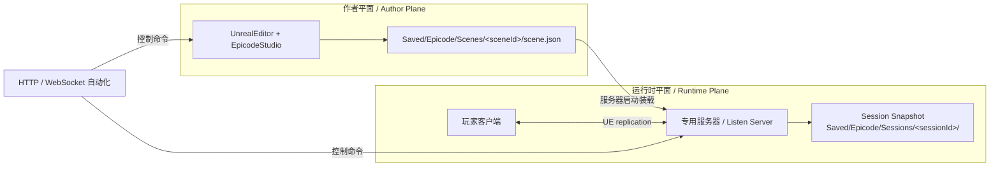
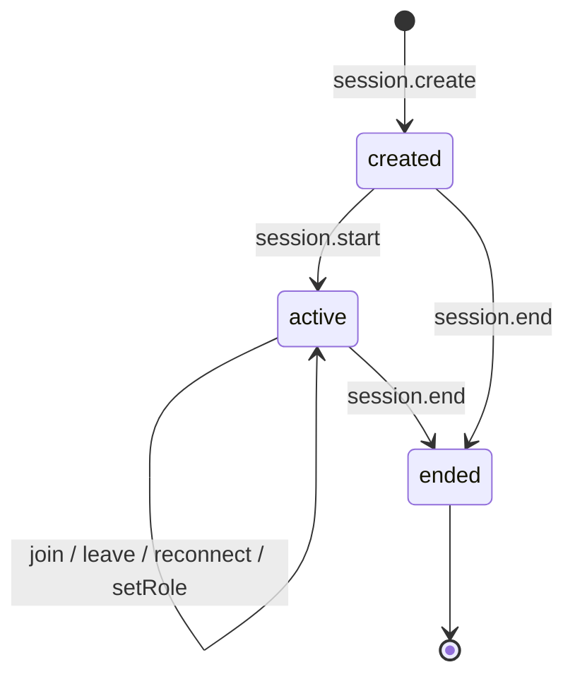

# Epicode 多人协同基线

本文描述 Epicode 的双平面架构、会话生命周期、角色与所有权、场景隔离、命令契约和当前实现边界。运行时 UE 复制层按阶段实现，已完成的会话控制平面可作为后续角色、移动、表演、物品和建造系统的权威状态源。

## 双平面



- 作者平面：场景 JSON 是唯一真相源，编辑器 Actor 是投影。
- 运行时平面：服务器从已保存场景装载，运行时修改只写会话文档，不覆盖原场景。
- 会话目录：`Saved/Epicode/Sessions/<sessionId>/session.json` 和 `events.jsonl`。
- 自动化客户端可通过 HTTP/WebSocket 连接服务器或编辑器/Headless 进程的 `EpicodeControlAPI`；玩家客户端通过 UE 复制和 RPC 连接到服务器。Studio 多人面板仍使用本进程命令，`Server` 输入尚未接入 HTTP 客户端。

## 沙盒会话桥

`FEpicodeNetworkSandboxBridge` 在 `session.create` 成功后把网络会话接到 `EpicodeSandbox` 世界。桥接只在 `EpicodeSandboxSettings.bEnableSandboxDirector=true` 时启用；关闭开关时网络会话继续按旧路径运行，不创建沙盒世界。

| 阶段 | 行为 |
| --- | --- |
| 创建 | 按 `sceneId` 从制作包根目录匹配 `production.json`；找到时调用 `Load`，否则调用 `LoadLegacy` 并把会话标记为 `legacy` |
| 启动 | 沙盒会话进入 `running`，初始化投影基线并绑定所有者 |
| 加入 | 把 `playerId` 绑定为沙盒参与者，写回角色实体 |
| 断线 | 参与者保留但 `bConnected=false`，同时清除接管标记 |
| 重连 | 复用原参与者并恢复角色，不产生重复参与者 |
| 结束/清理 | 先断开全部参与者，再关闭沙盒世界；重复关闭返回 `SANDBOX_NOT_CREATED`，不破坏旧会话 |

参与者映射：`viewer` → `Viewer`，`owner` → `Owner`，`agent` → `Agent`，其余表演者 → `Performer`。一个已连接角色同一时间只能绑定一个参与者，冲突返回 `CHARACTER_SLOT_TAKEN`；未知实体返回 `CHARACTER_NOT_FOUND`。Viewer 的交互、场景控制和会话管理请求在沙盒桥和网络会话两层都返回 `VIEWER_READ_ONLY`。

投影桥每次调用 `BuildProjection()` 输出 `upsert`/`remove` 命令，覆盖 `Character`、`Npc`、`Prop`、`Item`、`Build`、`Resource`、`Light` 和 `Camera`。`Trigger` 只存在于沙盒状态，不投影为 Actor；实体被移除或变为不可见后，下一次投影输出对应的 `remove` 命令，供运行时 Actor 同步清理。命令带 `entityId`、`kind`、`archetypeId`、位置、旋转和 JSON 数据，不直接修改作者场景。

复制摘要通过 `getReplicationSnapshot()` 提供，字段包括 `state`、`sessionId`、`digest`、`eventSequence`、`seed`、`replayable`、`legacy` 和事件数组。`collectEventsSince(sequence)` 把沙盒事件转换为 `FEpicodeNetworkEvent`，保留 `sequence`、`type`、`playerId`、`entityId` 和 `payload`。旧会话的 `replayable=false`，新制作包会话为 `true`。

## 会话状态



`session.create` 会校验场景存在、schema 版本和支持的实体，然后自动启动会话。重复创建、未启动加入、已结束启动、已结束加入都会返回错误码。

常用错误码：

| 错误码 | 含义 |
| --- | --- |
| `SCENE_NOT_FOUND` | 场景标识不存在 |
| `SCENE_VERSION_UNSUPPORTED` | 场景 schema 高于运行时支持版本 |
| `SCENE_ID_MISMATCH` | 请求标识与文档标识不一致 |
| `SESSION_NOT_FOUND` | 尚未创建会话 |
| `SESSION_ALREADY_EXISTS` | 未结束当前会话就再次创建 |
| `SESSION_FULL` | 连接玩家数达到 `MaxPlayers` |
| `VIEWER_SLOTS_FULL` | 连接查看者数达到 `MaxViewers` |
| `VIEWER_READ_ONLY` | 查看者尝试控制角色或修改世界 |
| `PARTICIPANT_KIND_MISMATCH` | 重连时参与者类型与已有记录不一致 |
| `PLAYER_NOT_FOUND` | 玩家不在会话中 |
| `PLAYER_DISCONNECTED` | 玩家断线且未重连 |
| `RECONNECT_EXPIRED` | 超过重连宽限期 |
| `FORBIDDEN` | 角色权限不足 |
| `CHARACTER_ALREADY_OWNED` | 角色已被其他玩家控制 |
| `PLAYER_ALREADY_HAS_CHARACTER` | 玩家已有其他角色 |
| `NOT_CHARACTER_OWNER` | 玩家不控制该角色 |
| `TARGET_DISCONNECTED` | 目标玩家已断线 |
| `INVALID_PARAMS` | 命令参数缺失或格式错误 |
| `CHARACTER_NOT_FOUND` | 沙盒桥找不到角色实体 |
| `CHARACTER_SLOT_TAKEN` | 角色已绑定其他已连接参与者 |
| `SANDBOX_DISABLED` | 功能开关关闭，未创建沙盒世界 |
| `SANDBOX_NOT_CREATED` | 沙盒桥尚未创建或已关闭 |

## 角色与权限

会话参与者有三种类型：

| 类型 | 角色 | 是否占角色 | 控制方式 |
| --- | --- | --- | --- |
| `performer` | `performer` 或 `owner` | 是 | UE Game 客户端或 Agent |
| `agent` | `performer` | 是 | HTTP/WebSocket 控制 API，无 GUI |
| `viewer` | `observer` | 否 | UE 查看客户端，只控制相机 |

`MaxPlayers` 只限制表演者和 Agent，`MaxViewers` 单独限制查看者。查看者不占角色，角色耗尽时仍可加入；查看者在服务器侧被强制只读，角色控制、物品、制作、建造和会话管理请求返回 `VIEWER_READ_ONLY`。

| 能力 | owner | director | performer | observer |
| --- | --- | --- | --- | --- |
| 查询会话 | 是 | 是 | 是 | 是 |
| 管理会话、踢人、改角色 | 是 | 否 | 否 | 否 |
| 控制场景、相机、灯光入口 | 是 | 是 | 否 | 否 |
| 控制自己的角色 | 是 | 否 | 是 | 否 |
| 物品、制作、建造 | 是 | 否 | 是 | 否 |
| 查看私有库存 | 是 | 否 | 是 | 否 |

所有者是创建会话的玩家，固定为 `owner`。`session.setRole` 只能在 `director`、`performer`、`observer` 之间切换，不能转移所有权。角色被改为 `observer` 时会释放当前角色。

## 角色所有权

- 一个角色同一时间只属于一个玩家。
- 所有者可以把任意未被占用的角色分配给 `performer` 或 `owner`，表演者也可以认领未被占用的角色。
- 查看者不分配角色，也不能认领或转移角色。
- `session.transferCharacter` 由所有者把角色从一名玩家转给另一名玩家，目标必须已连接且没有角色。
- 断线后角色保留 `ReconnectGraceSeconds` 秒，宽限期内重连会恢复角色。
- 宽限期结束后服务器释放角色，其他玩家可以重新认领。
- 会话子系统每 0.5 秒推进一次宽限期和自动导出，不依赖命令调用。
- 角色每 1 秒把权威位置和朝向写入会话玩家记录；重连时优先恢复该运行时变换，没有记录时回退到场景实体出生点。

## 角色生成、移动与复制

`EpicodeNetworkGameMode` 读取 `-EpicodeSessionScene=` 创建会话，`EpicodeNetworkPlayerController` 在 `ServerRegisterPlayer` 中认领场景角色。场景实体位置通过 `AEpicodeNetworkCharacter::MakeCapsuleSpawnLocation` 加上胶囊半高后作为出生点，`AlwaysSpawn` 保证位置不被关卡 PlayerStart 覆盖。

| 项目 | 值 | 说明 |
| --- | --- | --- |
| 服务端权威 | `UCharacterMovementComponent` | 服务器模拟，客户端预测，服务器校正 |
| 行走速度 | `400 cm/s` | 速度预算 = 速度 × DeltaSeconds × 1.15 容差 |
| 加速度/刹车 | `2048 cm/s²` | 避免瞬移式移动 |
| 瞬移上限 | `500 cm` | `ServerRequestTeleport` 拒绝超距传送 |
| 平滑模式 | `Exponential` | 远程角色位置平滑 0.10s、旋转 0.05s |
| 更新频率 | `30 Hz` / 最低 `10 Hz` | `NetPriority=2`，`NetCullDistanceSquared=100000000` |
| Root Motion | `IgnoreRootMotion` | 动画根运动不直接推动服务器角色 |

校正阈值默认为 50 cm：客户端与服务器偏差小于阈值时保留预测位置，超过阈值时回退到服务器位置。`AEpicodeNetworkPlayerController::ServerReportRemoteDrift` 每秒上报远程角色位置，服务器记录 `Remote drift` 日志，用于冒烟中的漂移检查。

重连流程：

1. 客户端断开，服务器调用 `LeaveSession`，玩家记录保留角色、外观和最近运行时变换。
2. 宽限期内同名客户端重新连接，`JoinSession` 复用离线玩家记录。
3. `ServerRegisterPlayer` 检测 `hasRuntimeTransform`，以记录的变换重新生成 Pawn，并恢复 `CharacterId` 与外观。
4. 超过宽限期后清除角色引用，下一次加入按新玩家分配空闲角色。

## 表演状态、表情与口型

`FEpicodePerformanceState` 是 `AEpicodeNetworkCharacter` 上的复制结构，服务器写入，客户端通过 `OnRep_Performance` 应用。

| 字段 | 类型 | 说明 |
| --- | --- | --- |
| `actionTag` | string | 当前动作，只允许字母、数字、`_`、`-`、`.`，最长 64 |
| `actionQueue` | string[] | 排队动作，服务器按 1 秒默认时长推进 |
| `emotion` | string | 情绪标签，最长 32 |
| `expressionIntensity` | 0–1 | 表情强度，越界拒绝 |
| `speaking` | bool | 说话状态 |
| `visemeSource` | enum | `none`、`audio`、`livelink`、`preset` |
| `motionMatchingActive` | bool | Motion Matching 是否实际启用 |

- 动作请求先校验标签；当前有动作且未打断时进入队列，`interrupt=true` 清空队列并立即播放。
- 客户端可调用 `PlayLocalActionPrediction` 记录预测动作标签；当前基线不驱动本地动画，服务器广播的状态仍是最终来源。
- 表情强度在服务器和 JSON 反序列化两处校验，微表情通过 `ApplyLocalMicroExpression` 只保留在本地。
- `Live Link` 或音频不可用时自动降级为 `preset`，返回 `LIVELINK_UNAVAILABLE` / `AUDIO_UNAVAILABLE` 警告。
- Motion Matching 请求只有在 `motionDataAvailable=true` 时激活，否则回退标准移动并返回 `MOTION_DATA_UNAVAILABLE`。
- 手部、脚部和视线 IK 通过 `UEpicodeLocalIKComponent` 在本地客户端求解。权重由 `ApplyLocalIKCorrections` 限制在 0–1；服务器、专用服务器和远程代理跳过求解；`LocalIKWeights` 不复制，`performance` 快照不包含本地 IK 字段。
- 本地 IK 需要配置 `LocalIK.IKRigAsset`、手部/脚部/视线目标名和骨骼名。资产、骨骼或动画实例缺失时记录一次 `LOCAL_IK_UNAVAILABLE` 警告并跳过，不影响服务器权威变换。
- 每个动作、表情和口型变更发布带 `sequence` 和 `timestamp` 的 `performance.*` 事件，快照字段 `performanceEvents` 返回这些事件。

## 物品、库存、制作与建造

`FEpicodeWorldState` 是会话内的服务器权威世界状态，随会话创建重置。当前基线把物品、库存、制作和建造保存为会话记录，尚未为每个物品生成独立 UE Actor；记录包含复制分类和所有者可见性，后续可据此投影 Actor。

| 结构 | 关键字段 | 说明 |
| --- | --- | --- |
| 物品 | `itemId`、`itemType`、`durability`、`quantity`、`anchor`、`ownerPlayerId`、`holderPlayerId`、`slot` | 服务器生成和修改；非所有者写入返回 `FORBIDDEN` |
| 库存 | `playerId`、`itemIds`、`capacity` | 默认 8 格，只对本人可见 |
| 制作 | `jobId`、`recipeId`、`playerId`、`startedAt`、`duration`、`outputItemId` | 材料在开始时扣除，完成时产出物品 |
| 建造 | `buildId`、`entityType`、`location`、`rotation`、`materialCost` | 校验边界、距离、碰撞和材料，撤销返还材料 |

交互规则：

- 拾取校验 `distance <= maxDistance`（默认 200 cm）、物品是否被其他玩家持有、库存容量。
- 持有、释放和放下只允许当前持有者；放下会清空所有者并移出库存。
- `inventory.get` 只允许本人读取，其他玩家返回 `FORBIDDEN`。
- 制作需要配方输入物品类型，缺少材料返回 `MISSING_MATERIALS`；取消后任务不可再次取消。
- 建造位置限制在 ±10000 cm、Z ≥ -500 cm，必须位于建造者 500 cm 范围内，且与其他建筑至少间隔 50 cm。
- 玩家离开会话时，其未完成制作任务转移给会话所有者，避免任务悬空。
- 每个变更发布 `item.*`、`craft.*`、`build.*` 事件，快照字段 `worldEvents` 返回这些事件。

## 命令

所有命令通过现有命令注册表执行，HTTP 使用 `POST /api/v1/command`：

```bash
TOKEN=$(cat engine/Saved/Epicode/api-token)
curl -sS -X POST http://127.0.0.1:8710/api/v1/command \
  -H "Authorization: Bearer $TOKEN" \
  -H "Content-Type: application/json" \
  -d '{"method":"session.create","params":{"sceneId":"<sceneId>","playerId":"owner-1","displayName":"Owner"}}'
```

| 方法 | 说明 |
| --- | --- |
| `session.create` | 创建并启动会话，参数 `sceneId`、可选 `playerId`、`displayName`、`maxPlayers`、`reconnectGraceSeconds` |
| `session.start` | 启动已创建会话，重复调用成功 |
| `session.join` | 加入会话，参数可选 `playerId`、`displayName`、`role` |
| `session.leave` | 玩家断线，参数 `playerId` |
| `session.reconnect` | 宽限期内重连，参数 `playerId` |
| `session.status` | 返回会话、端口、在线子系统和玩家计数 |
| `session.snapshot` | 返回权威快照，可选 `playerId` 做查询权限校验 |
| `session.export` | 写 `session.json` 和 `events.jsonl`，可选 `playerId` 要求所有者权限 |
| `session.end` | 结束会话，可选 `playerId` 要求所有者权限 |
| `session.kick` | 踢出玩家，参数 `requesterId`、`targetPlayerId` |
| `session.setRole` | 修改角色，参数 `requesterId`、`targetPlayerId`、`role` |
| `session.assignCharacter` | 分配角色实体，参数 `requesterId`、`characterId`、可选 `targetPlayerId` |
| `session.releaseCharacter` | 释放角色，参数 `requesterId`、可选 `targetPlayerId` |
| `session.transferCharacter` | 转移角色，参数 `requesterId`、`fromPlayerId`、`toPlayerId`、`characterId` |
| `network.status` | 返回端口、在线子系统、会话目录和最后错误 |
| `network.players` | 返回运行时 Pawn、外观、场景出生点和复制分类 |
| `performance.action` | 请求动作，参数 `playerId`、`action`、可选 `interrupt`、`duration` |
| `performance.expression` | 设置情绪和强度，参数 `playerId`、`emotion`、`intensity` |
| `performance.voice` | 设置说话和口型源，参数 `playerId`、`speaking`、`source` |
| `performance.motionMatching` | 启用 Motion Matching，参数 `playerId`、`enabled`、`motionDataAvailable` |
| `item.spawn` | 生成物品，参数 `requesterId`、`type`、`name`、可选 `x`、`y`、`z`、`durability`、`quantity` |
| `item.pickup` | 拾取物品，参数 `playerId`、`itemId`、可选 `distance`、`maxDistance` |
| `item.hold` / `item.release` / `item.drop` | 持握、释放、放下，参数 `playerId`、`itemId`，`hold` 可选 `slot` |
| `inventory.get` | 读取本人库存，参数 `requesterId`、`playerId` |
| `craft.start` / `craft.status` / `craft.cancel` | 制作开始、进度和取消，参数 `playerId`、`recipeId` 或 `jobId` |
| `build.confirm` / `build.undo` | 确认或撤销建造，参数 `playerId`、`entityType` 或 `buildId` |
| `world.status` | 返回物品、库存、制作和建造快照 |

快照字段：

- `sessionId`、`state`、`sceneId`、`sceneVersion`、`ownerPlayerId`、`createdAt`
- `maxPlayers`、`maxViewers`、`performerCount`、`viewerCount`、`reconnectGraceSeconds`、`worldVersion`、`eventSequence`
- `players[]`：`playerId`、`displayName`、`role`、`participantKind`、`connected`、`characterId`、`leaseId`、`stateVersion`
- `players[]` 额外包含 `hasRuntimeTransform`、`runtimeLocation`、`runtimeRotation`；断线玩家包含 `disconnectedAt`
- `characters[]`：`entityId`、`playerId`、`replicationClass`、`netUpdateFrequency`
- `performanceEvents[]`：`sequence`、`timestamp`、`type`、`playerId`、`entityId`、`payload`
- `worldEvents[]`：物品、制作和建造事件，字段与 `performanceEvents` 一致

事件流按 `sequence` 单调递增，默认保留最近 4096 条。请求的序号早于保留窗口时，`session.snapshot` 应重新获取完整快照。事件文件一行一个 JSON 对象，便于日志工具增量读取。

## 场景隔离

- `session.create` 只读取 `Saved/Epicode/Scenes/<sceneId>/scene.json`。
- 装载时校验 schema 版本、场景标识和文档完整性。
- 运行时状态写入 `Saved/Epicode/Sessions/<sessionId>/`，不写作者平面场景。
- `session.export` 只写会话目录，退出时不会覆盖原场景。
- 未来版本、损坏 JSON 或不支持实体都会拒绝装载，原场景保持不变。

## 启动脚本

```bash
cd engine
./Scripts/Server.sh --port 7777 --scene <sceneId>
./Scripts/Client.sh --server 127.0.0.1:7777 --name Alice
./Scripts/Client.sh --server 127.0.0.1:7777 --name Bob -nullrhi
./Scripts/NetworkSmoke.sh --scene <sceneId>
```

- 端口占用时 `Server.sh` 返回非零状态并输出错误。
- `EPICODE_GAME_PORT`、`EPICODE_SESSION_SCENE`、`EPICODE_SERVER`、`EPICODE_PLAYER_NAME` 可覆盖默认值。
- 额外参数放在 `--` 之后，或直接作为未知参数透传给 Unreal。
- 当前安装的引擎发行版不支持独立 `Server` 构建目标，`Server.sh` 会优先使用 `Binaries/Linux/EpicodeVideoServer`，否则回退到 `UnrealEditor-Cmd -server`。
- `Build.sh` 的 Server 目标失败时返回退出码 6，并在 `Saved/Logs/build-server-target.log` 记录请求目标、引擎错误和 `serverMode=editor-fallback`。`Server.sh` 写入 `Saved/Logs/server-fallback.log`，实际模式通过 `system.health.network.serverMode`、`serverTargetSupported`、`fallbackReason` 和 `serverBinary` 暴露。
- `Client.sh` 支持 `--mode auto|game|editor`；`auto` 优先 Game 二进制，Game 缺失或启动退出时回退 `UnrealEditor -game`，并写入 `Saved/Logs/client-fallback.log` 的 `clientMode`、实际二进制和回退原因。
- `NetworkSmoke.sh` 自动生成双角色场景夹具，启动服务器和两个无界面客户端，校验出生点、外观、远程插值、移动漂移、断线重连和 `session.json` 所有权。摘要写入 `Saved/Logs/network-smoke.log` 和 `network-smoke-summary.json`，包含 `sampleCount`、`maxRecentDrift`、`rttMs`、`packetLoss`、`serverMode` 和快照角色映射；未采样的 RTT/丢包写 `not-measured`。成功后删除夹具。
- 服务器和客户端默认用 `stdbuf -oL` 行缓冲日志，避免冒烟等待日志时受标准输出块缓冲影响。

## 配置

`engine/Config/DefaultEpicode.ini`：

```ini
[/Script/EpicodeNetwork.EpicodeNetworkSettings]
GamePort=7777
MaxPlayers=8
ReconnectGraceSeconds=60
SessionRoot=Saved/Epicode/Sessions
DefaultCharacterEntityId=
DefaultCharacterMesh=
OnlineSubsystem=LAN
bAllowRemote=False
bAutoExportSession=True
LocalIK=(bEnabled=False,IKRigAsset="",HandGoalName="HandRight",FootLeftGoalName="FootLeft",FootRightGoalName="FootRight",LookAtGoalName="LookAt",HandBoneName="hand_r",FootLeftBoneName="foot_l",FootRightBoneName="foot_r",LookAtBoneName="head",HandTargetOffset=(X=0,Y=0,Z=0),FootTargetOffset=(X=0,Y=0,Z=2),LookAtDistance=500,bDrawDebug=False)
```

`system.health` 的 `network` 字段包含 `module`、`moduleLoaded`、`onlineSubsystem`、`port`、`maxPlayers`、`sessionRoot`、`state`、`sessionId`、`sceneId`、`playerCount`、`connectedPlayers`、`lastError`、`serverMode`、`serverTargetSupported`、`fallbackReason`、`serverBinary` 和 `clientMode`。`session.snapshot` 也包含这五个运行模式字段。启用沙盒桥时还会带 `sandbox` 对象：`state`、`sessionId`、`digest`、`eventSequence`、`seed`、`replayable`、`legacy`、`events[]`。

## 当前边界

已完成：

- 会话生命周期、玩家加入/离开、满员、重连宽限期。
- 角色权限矩阵、角色分配/转移/释放、断线保留与超时释放。
- 会话快照、世界版本、单调事件序号、事件缺口检测和导出。
- 场景装载校验、作者平面与运行时平面隔离。
- 命令注册和 `system.health` 网络状态。
- `EpicodeNetworkGameMode`、`EpicodeNetworkPlayerController` 和 `EpicodeNetworkCharacter` 的运行时加入链路。
- 场景角色出生点映射、骨骼网格外观复制、PlayerController 占有和快照所有权验证。
- 服务器权威移动、客户端预测、速度预算与瞬移校验、远程插值和 Root Motion 禁用。
- 断线重连后的角色、外观和运行时变换恢复。
- 网络冒烟的移动、远程漂移、重连和 `stat net` 采样。
- 复制表演状态、动作队列、中断、表情强度、口型降级、Motion Matching 回退和表演事件。
- 网络冒烟自动触发动作、表情和口型，快照包含 6 条 `performance.*` 事件。
- 会话级物品、库存、制作和建造权威状态，包含材料扣除、完成产出、撤销返还和世界事件。
- Studio 多人会话面板（本进程和远程控制 API 两种模式）、令牌掩码、1 秒异步轮询、玩家/角色列表、角色分配、表演者 HUD、导演控制台和重连/结束状态。
- 双客户端网络冒烟覆盖动作、表情、口型、拾取、制作、建造、重连和事件计数。
- 网络会话与沙盒世界生命周期桥接，演员阵容绑定、角色槽位冲突、重连恢复和 Viewer 只读在桥接层强制执行。
- 沙盒投影命令覆盖角色、NPC、道具、物品、建造物、资源、灯光和相机，并生成不可见/移除实体的清理命令。
- 沙盒摘要与增量事件复制，旧会话标记 `legacy=true`、`replayable=false`，可通过功能开关整体回退。
- 编辑器自动化测试和全量回归。

进行中：

- 物品 Actor 级复制和建造 Actor 投影；当前世界状态保存在会话记录中，通过命令读写。
- `EpicodeControlAPI` 是 Runtime 模块，服务器和编辑器/Headless 进程都会监听 HTTP/WS；Game 客户端不绑定控制端口。Studio 面板已接入远程 JSON-RPC，但尚未接入 WebSocket 事件推送。
- `EpicodeVideo` Game 目标可构建，但未打包的 Game 二进制启动时可能崩溃（`BufferReader` 断言）；`Client.sh` 的 `auto` 会尝试 Game 并回退 `UnrealEditor -game`，独立客户端包需要后续打包和运行时修复。
- 真实带宽、延迟和丢包曲线仍需在带网络模拟的环境中单独采样。

## 网络基线

2026-11-24 双客户端冒烟（`Saved/Logs/network-smoke-summary.json`）：

| 指标 | 观测值 |
| --- | --- |
| 服务器模式 | `editor-fallback`，`UnrealEditor-Cmd -server` |
| 漂移样本 | 58 |
| 最近 10 个样本最大漂移 | 85.76 cm（阈值 300 cm） |
| RTT | `not-measured` |
| 丢包 | `not-measured` |
| 采样范围 | `local-loopback` |

2026-11-04 双客户端冒烟（`Saved/Logs/network-smoke.log`）：

| 指标 | 观测值 |
| --- | --- |
| 玩家数 | 2（Alice、Bob） |
| 角色数 | 2 个场景角色 |
| 角色更新频率 | 30 Hz，最低 10 Hz |
| 复制优先级 | 2 |
| 相关距离 | 10000 cm |
| 远程漂移样本 | 48 |
| 最近 10 个样本最大漂移 | 91.92–205.74 cm（多次本地回环，阈值 300 cm） |
| 重连 | Bob 断开后宽限期内恢复，`restored=1` |
| 表演事件 | 6 条（动作/表情/口型各 2 名玩家） |
| 口型降级 | `LiveLink` → `preset` 警告 |
| 世界事件 | 8 条（物品生成/拾取、制作开始、建造确认各 2 名玩家） |
| `stat net` | 客户端启动参数执行并写入摘要 |

该表记录复制参数和可重复的漂移指标；真实带宽、延迟和丢包曲线需要在带网络模拟的环境中另行采样，当前不把本地回环结果当作带宽基线。

冒烟地图没有地面碰撞，角色移动后会自由下坠；漂移样本和重连负 Z 只用于验证复制、插值和运行时变换恢复链路，不代表地面移动质量。

## 验证

```bash
cd engine
./Scripts/Build.sh
./Scripts/Test.sh
```

当前 `Epicode.Network.*` 覆盖：

- `Epicode.Network.SessionLifecycle`
- `Epicode.Network.Reconnect`
- `Epicode.Network.Permissions`
- `Epicode.Network.Ownership`
- `Epicode.Network.IK`
- `Epicode.Network.ServerFallback`
- `Epicode.Network.Snapshot`
- `Epicode.Network.Commands`
- `Epicode.Network.SceneLoad`
- `Epicode.Network.SceneIsolation`
- `Epicode.Network.SessionExport`
- `Epicode.Network.Health`
- `Epicode.Network.RuntimeDefaults`
- `Epicode.Network.Movement`
- `Epicode.Network.Interpolation`
- `Epicode.Network.ReplicationPriority`
- `Epicode.Network.PerformanceState`
- `Epicode.Network.Actions`
- `Epicode.Network.Expression`
- `Epicode.Network.VoiceDrive`
- `Epicode.Network.MotionMatching`
- `Epicode.Network.IK`
- `Epicode.Network.PerformanceEvents`
- `Epicode.Network.Items`
- `Epicode.Network.ItemInteraction`
- `Epicode.Network.Inventory`
- `Epicode.Network.Crafting`
- `Epicode.Network.Building`
- `Epicode.Network.WorldEvents`
- `Epicode.Network.WorldPermissions`
- `Epicode.Network.SandboxIntegration`
- `Epicode.Network.CastBinding`
- `Epicode.Network.Projection`
- `Epicode.Network.SandboxReplication`
- `Epicode.Network.LegacySession`

双客户端冒烟：

```bash
./Scripts/NetworkSmoke.sh --scene <sceneId>
```

成功时输出 `Epicode network smoke passed`。

## Agent、Viewer 与混合参与者

运行时客户端分为表演者、Agent 和 Viewer 三类。Agent 使用 `performer` 角色但 `participantKind=agent`，通过 HTTP/WebSocket 控制一个角色并持有租约；Viewer 使用 `observer` 角色和 `participantKind=viewer`，只控制自己的观察相机。

```json
{
  "maxPlayers": 8,
  "maxViewers": 4,
  "performerCount": 3,
  "viewerCount": 1,
  "agentLeases": [
    {"playerId": "agent-1", "characterId": "...", "leaseId": "...", "leaseExpiresAt": 18957.0, "leaseSeconds": 30, "stateVersion": 4}
  ],
  "viewerCameras": [
    {"playerId": "viewer-1", "mode": "follow", "cameraId": ""}
  ],
  "events": []
}
```

- `MaxPlayers` 只计算表演者和 Agent；`MaxViewers` 单独计算 Viewer。
- Viewer 不占角色，角色耗尽时仍可加入；离开和重连不影响角色所有权。
- Agent 租约在 `AgentLeaseSeconds` 后过期，服务器停止移动、释放角色并发布 `agent.lease.expired`。
- Agent 命令通过 `X-Epicode-Participant` 绑定；Viewer 调用返回 `FORBIDDEN`，Viewer 控制角色返回 `VIEWER_READ_ONLY`。
- 快照 `events` 按会话顺序列出全部运行时事件，WebSocket 使用 `since` 和过滤器补发。

新增验证：

- `Epicode.Network.AgentLease`
- `Epicode.Network.AgentLeaseExpiry`
- `Epicode.Network.AgentObservation`
- `Epicode.Network.AgentLimits`
- `Epicode.Network.SnapshotParticipants`
- `Epicode.Network.ViewerSpawn`
- `Epicode.Network.ViewerAuth`
- `Epicode.Network.ViewerLifecycle`
- `Epicode.Network.ViewerReadOnly`
- `Epicode.Network.MixedParticipants`
- `Epicode.Viewer.CameraModes`
- `Epicode.Viewer.SceneCameras`

Agent 与 Viewer 冒烟：

```bash
./Scripts/AgentSmoke.sh
./Scripts/ViewerSmoke.sh
```

成功时分别输出 `Epicode agent smoke passed` 和 `Epicode viewer smoke passed`。详细入口见 `Docs/AgentClient.md`、`Docs/ViewerClient.md` 和 `Docs/ControlAPI.md`。
