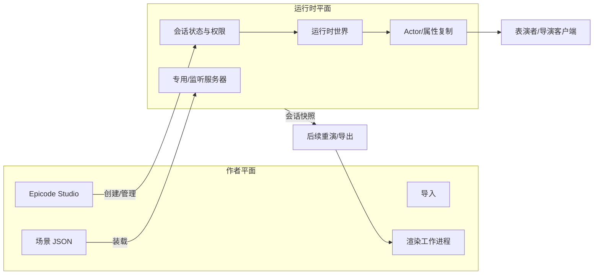

# Design

## Context

当前实现是一个 UE 5.8.4 Linux 编辑器扩展，现有能力由 `EpicodeCore`、`EpicodeImport`、`EpicodeControlAPI`、`EpicodeStudio` 和 `EpicodeRender` 五个插件组成。场景 JSON 是唯一事实源，Actor 是投影；Studio、HTTP/WebSocket 和渲染工作进程共享命令注册表。现有 spec 明确把多人协同列为非目标。

新设计文档把目标扩展为多人协同剧情视频制作平台，技术基线是 UE 5.6+、Client-Server 权威服务器、Actor/属性复制、RPC、Replication Graph、Take Recorder、Sequencer 和 Movie Render Queue。文档同时要求 DX12 以支持 MetaHuman Animator，而当前工程以 Linux + Vulkan 为基线，这是本设计必须显式处理的平台冲突。

本设计只覆盖设计文档建议的第一阶段 P1–P3：网络基线、物品/制作/建造、动作/表情/口型。P4–P8 保留扩展点和阶段计划，但不在本变更中实现。

## Goals / Non-Goals

**Goals:**

- 在不破坏现有单用户编辑器、导入和渲染链路的前提下，新增独立的多人运行时平面。
- 建立服务器权威的会话、玩家身份、角色所有权、权限、重连和诊断基线。
- 让编辑器场景 JSON 可以作为会话的初始世界，同时把运行时变化隔离到会话快照。
- 通过 UE 复制和 RPC 实现玩家角色移动、动作、表情和口型关键状态的多人一致表现。
- 实现服务器权威的物品、库存、制作和建造，形成可测试的多人互动闭环。
- 为后续 P4–P8 的重演、Take Recorder、多机位和导出保留稳定的事件、快照和相机契约。

**Non-Goals:**

- 不实现 P4 场景控制（天气、时间、声音、特效）的完整多人编辑。
- 不实现 P5 资产注册表的权限、依赖和版本哈希。
- 不实现 P6 重演/Take Recorder、P7 多机位导出和 P8 Replication Graph 调优。
- 不把 MetaHuman Animator、Audio2Face 或 Live Link Face 设为 Linux 服务器或基础客户端的硬依赖。
- 不把现有 HTTP/WebSocket 改造成玩家游戏传输层；玩家移动和表演使用 UE 网络复制。
- 不实现语音音频传输、混音和降噪；本阶段只同步说话状态和口型驱动源，语音音频留给后续声音系统变更。
- 不承诺 Windows 客户端的完整打包、签名和商店分发。

## Decisions

### D1. 采用“作者平面 + 运行时平面”的双平面架构

现有编辑器、场景 JSON、导入和渲染保留为**作者平面**。新增 `EpicodeNetwork` 作为**运行时平面**，负责会话、玩家、复制、权限和运行时世界。

这样做的原因是多人运行时状态的生命周期、权限和复制频率与编辑器文档完全不同。把两者混在一个文档里会让保存、撤销、重连和回放互相污染。替代方案是直接把 `UEpicodeSceneDocument` 扩展为网络文档，但会让现有单用户语义和渲染快照承担不必要的网络状态。

### D2. 专用服务器和监听服务器共享同一套会话服务

服务器使用独立 `EpicodeVideoServer` 目标。监听服务器使用同一套会话服务，只是在本地同时承载客户端。会话服务不依赖 Editor 模块，因此可以在专用服务器、监听服务器和无界面测试进程中运行。

替代方案是只在编辑器进程中以 `-server` 运行。该方案开发方便，但会把 Editor、导入和渲染模块带入服务器，扩大攻击面并让打包路径不清晰。首版保留编辑器内本地会话用于调试，但正式服务器使用 Server 目标。

### D3. 编辑器场景文档是会话输入，会话快照是运行时事实

会话启动时通过场景标识加载已保存的场景 JSON，校验 schema 版本、实体类型和资产引用，然后在服务器世界重建受支持实体。运行时移动、动作、物品和建造写入 `FEpicodeSessionDocument`，不写回 `Saved/Epicode/Scenes/<sceneId>/scene.json`。

会话快照至少包含：

- `sessionId`、协议版本、场景标识和场景版本。
- 玩家列表、玩家角色、角色所有权和连接状态。
- 运行时实体列表、变换、可见性和活动相机。
- 角色表演状态、物品/库存、制作任务和已建造结构。
- 世界版本、事件序号和活动相机标识。

会话目录为 `Saved/Epicode/Sessions/<sessionId>/`，保存 `session.json`、`events.jsonl` 和结束摘要。后续重演可以直接消费事件日志，不需要重新解释编辑器文档。

替代方案是运行时直接修改场景 JSON。该方案会让多人游玩污染作者资产，也无法处理会话结束后的回滚和重放，因此不采用。

### D4. 玩家角色使用可移动角色，编辑器角色投影保持不变

编辑器中的 `character` 实体继续由现有骨骼网格 Actor 投影。会话中的表演者角色使用可移动角色（`ACharacter` + `CharacterMovementComponent`）投影，加载时应用场景角色的骨骼网格、动画集、初始变换和外观数据。

表现层映射：

- 本地玩家：客户端预测移动，服务器校正。
- 远程玩家：服务器位置 + 客户端插值，不直接复制 Root Motion。
- 导演/观察者：无表演角色，使用观察 Pawn 或自由相机。
- 断线重连：角色实体不重建，重新绑定 PlayerController 和所有权。

替代方案是继续使用现有静态投影 Actor 并手写移动复制。该方案会重复 `CharacterMovementComponent` 的预测、台阶、地面检测和网络校正，工作量和风险都更高。

### D5. 表演状态只复制关键状态，面部细节本地生成

服务器复制 `PerformanceState`：

- 当前动作标签、动作优先级和动作队列。
- 情绪枚举、表情强度、是否说话、口型驱动源。
- 当前动作开始时间和可选的循环标记。

动作请求通过服务器 RPC 校验前置条件，成功后广播权威动作事件；允许本地客户端先播放预测动画。表情、眨眼、呼吸、口型 morph 和 IK 修正留在本地表现层，不逐帧复制。

口型驱动采用接口化策略：

- `None`：不驱动。
- `Audio`：本地音频分析驱动。
- `LiveLink`：本地 Live Link 设备驱动，插件不可用时降级。
- `Preset`：预设口型，跨平台保底。

替代方案是逐帧复制 morph target 或骨骼姿势。该方案带宽高、抗丢包差，而且观众端并不需要与表演者完全逐帧一致。

### D6. 物品、库存、制作和建造复用现有道具/场景资产，但使用独立运行时状态

物品和结构不是新的编辑器实体类型，而是带运行时组件的道具/结构投影。场景中的 `prop` 可以通过 `item` 或 `structure` 负载声明物品属性、交互锚点、摆放规则和建造标签。服务器会话维护独立的库存、制作任务和结构状态。

因此：

- 编辑器场景格式保持向后兼容。
- 物品和结构可以复用现有静态网格、材质和变换投影。
- 运行时状态不进入场景 JSON，只有显式导出或后续重演才写入会话/片段文档。

替代方案是新增 `item` 和 `structure` 实体类型。那会触发场景 schema 迁移、Studio 检查器和现有命令的全面改动，不适合作为第一阶段。

### D7. HTTP/WebSocket 是服务器侧控制面，玩家传输走 UE 网络

玩家移动、动作、表情、物品和建造使用 UE RPC/复制，避免在游戏帧内走 HTTP。HTTP/WebSocket 保留给：

- Studio 所有者创建、查询和结束会话。
- 导演工具和自动化脚本查询会话快照、发出授权控制命令。
- 外部流水线订阅会话事件。

HTTP 请求仍使用现有 Bearer Token 鉴权。会话命令在参数中携带 `sessionId` 和 `playerId`，服务器按会话成员和角色校验。控制器/RPC 路径和 HTTP 路径共用同一套领域处理器，避免两套权限逻辑。

替代方案是让所有客户端都通过 HTTP 发命令。该方案无法利用 UE 的移动预测、相关性和 RPC 批处理，也会把控制 API 暴露给每个表演者，因此不采用。

### D8. 权限使用固定角色矩阵，服务器逐请求校验

首版角色：

| 能力 | 所有者 | 导演 | 表演者 | 观察者 |
| --- | --- | --- | --- | --- |
| 创建/结束会话、踢人、分配角色 | 是 | 否 | 否 | 否 |
| 查询会话、接收事件 | 是 | 是 | 是 | 是 |
| 控制自己的角色 | 是 | 否 | 是 | 否 |
| 控制授权相机/灯光 | 是 | 是 | 否 | 否 |
| 拾取/制作/建造 | 是 | 否 | 是 | 否 |
| 查看私有库存 | 自己 | 否 | 自己 | 否 |

服务器在每个修改请求应用前检查角色、所有权和会话状态。失败返回稳定领域错误，并记录审计事件。角色变更在下一个请求生效，不要求强制断开客户端。

替代方案是使用 UE 的通用权限组件或插件。首版角色少、规则集中，固定矩阵更容易测试和审计。

### D9. 网络基线使用标准复制和相关度，Replication Graph 留到 P8

首版使用 UE 标准 Actor 复制、属性复制、RPC、网络相关度和优先级：

- 角色 Pawn：高优先级、较高更新频率。
- 相机、灯光、导演控制：中优先级、低频更新。
- 场景道具：仅在状态变化时同步，使用休眠/相关度减少流量。
- 库存：只复制给拥有者。
- 表情/口型：只复制关键状态。

Replication Graph、分层相关度和更激进的带宽预算留到 P8，因为需要真实多人负载数据才能调参。首版通过 `stat net`、会话统计和双客户端冒烟记录基线，避免在没有数据时过早优化。

### D10. 平台策略：Linux 服务器 + Linux 客户端基线，Windows 客户端可选

设计文档的 DX12 要求来自 MetaHuman Animator，而当前工程是 Linux + Vulkan。首版采用：

- Linux x86_64 专用服务器。
- Linux 客户端用于 CI、无头网络测试和基础表演。
- Windows 客户端作为可选目标，承载 MetaHuman Animator、Audio2Face 和 Live Link Face 等 Windows 侧能力；不在本变更验收范围内。
- UE 5.8.4 作为唯一基线，满足文档的 5.6+ 要求。
- MetaHuman、Audio2Face、Live Link 通过可选插件和能力探测启用，不作为服务器依赖。

替代方案是立即把整个工程迁到 Windows/DX12。那会破坏现有 Linux 构建、测试和渲染证据，也无法在当前离线环境验证。先保持 Linux 服务器和可测试基线，再为 Windows 客户端增加独立构建/验收更稳妥。

### D11. Motion Matching 和 IK 作为可降级的表现层

Motion Matching 使用 Pose Search 数据资产和本地轨迹。启用时：

- 服务器仍以 `CharacterMovementComponent` 位置为权威。
- 远程角色不复制 Root Motion，使用权威位置插值。
- 本地轨迹和姿态数据库只影响表现。
- 缺少 Pose Search 数据或平台不支持时回退到标准移动动画。

IK 手部贴合、脚部防穿地、视线跟随只修改本地骨骼表现，不写回权威位置。这样可以在不牺牲网络稳定性的前提下逐步引入高质量动作。

### D12. 会话事件和快照为后续重演预留契约

虽然 P6 才实现重演/Take Recorder，本阶段仍固定事件契约：

- 每个事件包含 `sessionId`、`sequence`、`timestamp`、`type`、`playerId`、`entityId`、`payload`。
- 事件类型至少覆盖 `session.*`、`player.*`、`performance.*`、`item.*`、`craft.*`、`build.*`。
- 会话快照包含世界版本和事件序号，客户端可以从快照 + 增量事件恢复。
- 会话结束摘要保留玩家、角色、物品、结构和事件统计。

后续 P6 可以把事件日志转换为重演时间轴，P7 可以按相机轨道拆分渲染作业，而不需要重新定义会话事件。

### D13. 验证采用分层测试和双进程网络冒烟

验证分三层：

1. **领域单元测试**：权限矩阵、角色状态机、库存、配方、建造校验、会话快照序列化。
2. **服务器集成测试**：无界面服务器加载场景、创建会话、模拟加入/离开/重连、应用世界修改。
3. **双客户端网络冒烟**：脚本启动专用服务器和两个客户端，验证加入、角色分配、移动、动作、拾取、制作、建造、角色切换、断线重连和事件顺序。

现有 30 个 `Epicode.*` 测试必须继续通过。网络冒烟使用独立端口和临时会话目录，避免污染日常 `Saved/Epicode/`。

## Risks / Trade-offs

| 风险 | 影响 | 对策 |
| --- | --- | --- |
| 双平面增加状态同步复杂度 | 会话快照与编辑器文档可能漂移 | 明确作者平面只读装载、运行时只写会话快照；增加隔离测试 |
| 移动预测与 Motion Matching 冲突 | 远程角色漂移或抖动 | 服务器位置权威、远程插值、不复制 Root Motion；Motion Matching 可回退 |
| 面部和口型跨平台能力不一致 | Windows/GUI 客户端表现与 Linux 不同 | 驱动源接口化，Live Link/Audio2Face 可选，预设口型保底 |
| 多人录制/回放尚未实现 | 本阶段不能直接输出成片 | 固定事件和快照契约，P6/P7 再接入 Take Recorder 和 MRQ；现有单用户渲染不受影响 |
| 标准复制在多人负载下不够 | 带宽和 CPU 压力 | 首版记录基线，P8 再引入 Replication Graph 和分层相关度 |
| HTTP 与 UE 网络双路径权限不一致 | 越权或重复校验 | 共用领域处理器和权限矩阵；HTTP 仅面向受信操作者，玩家走 RPC |
| Windows/DX12 依赖无法在当前环境验证 | MetaHuman 路径未验收 | 把 Windows 客户端列为可选后续目标，Linux 基线先完成网络和表演链路 |
| 物品/结构复用 prop 可能限制玩法扩展 | 后续需要更复杂物品状态 | 运行时组件和负载可扩展；若需要独立实体类型，另起 schema 迁移变更 |

## Migration Plan

1. 新增 `EpicodeNetwork` 插件、Server/Client 目标和脚本，默认不改变现有 Editor 启动行为。
2. 增加网络配置项，默认 LAN 直连、关闭在线子系统；不监听游戏端口，直到创建或加入会话。
3. 现有场景 JSON 不迁移；会话装载只读，运行时状态写入新的 `Saved/Epicode/Sessions/`。
4. 新增自动化测试和双客户端冒烟，先与现有 30 个测试并行运行，再纳入验收脚本。
5. 若网络功能需要回滚，禁用 `EpicodeNetwork` 插件和 Server/Client 目标即可；编辑器、场景、导入和渲染文件不需要回退。
6. Windows 客户端不在本变更内，由后续独立构建变更加入，不改变 Linux 服务器和现有 CI 的默认路径。

## Phase Map

| 阶段 | 内容 | 本变更 |
| --- | --- | --- |
| P1 | 多人登录、会话、角色生成、基础移动同步 | 是 |
| P2 | 物品、库存、制作、建造 | 是 |
| P3 | 动作、表情、口型、Motion Matching/IK 降级 | 是 |
| P4 | 灯光、天气、声音、特效的场景控制 | 否，后续变更 |
| P5 | 场景/角色导入扩展、资产注册表 | 否，后续变更 |
| P6 | 重演事件、Take Recorder、多机位录制 | 否，后续变更 |
| P7 | Movie Render Queue 多机位导出、视频管理 | 否，后续变更 |
| P8 | Replication Graph、带宽优化、完整权限管理 | 否，后续变更 |

## Open Questions

- 生产环境优先使用 Steam 还是 EOS，需要等在线子系统账号和打包流程确定；首版 LAN 直连不阻塞。
- Windows 客户端的 MetaHuman/Audio2Face 插件版本和许可需要在 Windows 构建环境确认。
- 具体动作集、Pose Search 数据库和角色骨骼规范需要在资产管线确定后补充。
- P6 的会话事件到 Take Recorder 时间轴映射格式，留到重演变更中定义。
