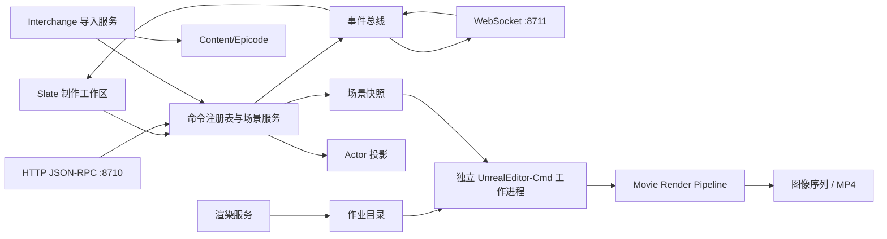
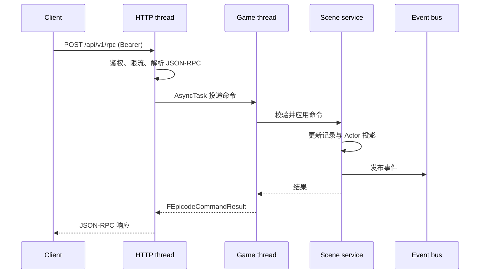

# Design

## Context

仓库当前只有 OpenSpec 规划目录和空的 `engine/`，没有既有运行时代码或构建系统。目标引擎安装在 `/usr/local/unreal`，版本为 Unreal Engine 5.8.4（`++UE5+Release-5.8`），Linux x86_64，具备 Vulkan 渲染所需的 NVIDIA RTX A6000。构建工具链已有 clang 21、CMake、Ninja 和 32 个 CPU 核心。

本设计只解决 HOW。需求与验收行为见 `proposal.md` 和 `specs/*/spec.md`。关键外部约束如下：

- 只能新增 `engine/` 下的项目和插件，不修改 `/usr/local/unreal`。
- 制作界面、导入和渲染都依赖 Editor 目标，但控制 API 和核心场景模型应能在无界面 Editor 进程中工作。
- 视频渲染需要 GPU，控制服务本身不需要 RHI。
- 单机、单用户、默认只监听回环地址，不做多租户或远程公网部署。

## Goals / Non-Goals

**Goals:**

- 建立可编译、可启动、可测试的 UE 5.8 C++ 项目，并把五个能力拆成清晰模块。
- 用一份可序列化的场景文档作为唯一事实来源，界面和 API 共享同一套命令语义。
- 让 API 在编辑器和无界面进程中都可工作，并保持请求、事件和错误行为一致。
- 让渲染与编辑解耦，使用场景快照和独立工作进程，避免编辑操作污染正在输出的视频。
- 为导入、场景、API、渲染分别提供可自动执行的验收路径。

**Non-Goals:**

- 不实现自研渲染器、路径追踪器或视频编码器，全部复用 UE 5.8 的 Movie Render Pipeline。
- 不实现时间线剪辑、转场、字幕、音频混音等 NLE 功能。
- 不实现多人协同、云渲染农场、远程公网访问或浏览器版制作界面。
- 不承诺 Windows、macOS 或移动端构建，首版只支持 Linux x86_64。
- 不追求任意 `.umap` 中所有 Blueprint 行为在场景 JSON 中的无损重建，只保证受支持的实体类型。

## Architecture Overview



核心原则是“记录是事实，Actor 是投影”。所有场景状态先写入实体记录和场景文档，再由投影层同步到 UE Actor。撤销、重做、保存、API 查询和渲染快照都围绕记录工作，避免把 Actor 生命周期当作状态真相。

### Module layout

| 插件 | 模块类型 | 主要职责 | 主要依赖 |
| --- | --- | --- | --- |
| `EpicodeCore` | Runtime | 实体记录、场景文档、命令注册表、快照、事件总线、Actor 投影、环境控制器、设置 | Core, CoreUObject, Engine, Json, JsonUtilities, DeveloperSettings |
| `EpicodeImport` | Editor | 文件分类、格式能力探测、Interchange 导入、资产落盘、场景放置、导入索引、取消 | Core, CoreUObject, Engine, UnrealEd, InterchangeCore, InterchangeEngine, InterchangeImport, InterchangePipelines, AssetTools, AssetRegistry, MeshDescription, StaticMeshDescription, SkeletalMeshDescription |
| `EpicodeControlAPI` | Runtime | HTTP JSON-RPC、WebSocket、鉴权、票据、幂等、限流、作业查询、事件推送 | Core, CoreUObject, Engine, HTTPServer, WebSocketNetworking, Sockets, Networking, Json, JsonUtilities |
| `EpicodeStudio` | Editor | Slate 工作区、导入面板、大纲、检查器、渲染面板、API 面板、撤销集成 | Core, Import, Render, ControlAPI, UnrealEd, Slate, SlateCore, EditorStyle, ToolMenus, WorkspaceMenuStructure, LevelEditor, ContentBrowser, PropertyEditor, DesktopPlatform, HTTP, InputCore |
| `EpicodeRender` | Editor | 渲染作业、场景快照、工作进程启动、MRQ 配置、进度、验证、产物登记 | Core, CoreUObject, Engine, UnrealEd, MovieRenderPipelineCore, MovieRenderPipelineRenderPasses, MovieRenderPipelineSettings, MovieRenderPipelineEditor, MovieRenderPipelineMP4Encoder, MovieScene, LevelSequence, MovieSceneTracks, RenderCore, RHI, Json |

`EpicodeImport` 和 `EpicodeRender` 在启动时向 `EpicodeCore` 的命令注册表注册自己的方法，因此 `EpicodeControlAPI` 不需要依赖任何 Editor 模块。无界面 Editor 进程加载这两个模块后，导入和渲染 API 可用。纯 Runtime 或 Shipping 构建中，API 只暴露系统、场景和实体方法。

### Project layout

```text
engine/
  EpicodeVideo.uproject
  Config/
    DefaultEngine.ini
    DefaultGame.ini
    DefaultEditor.ini
    DefaultEpicode.ini
  Source/
    EpicodeVideo.Target.cs
    EpicodeVideoEditor.Target.cs
    EpicodeVideo/
      EpicodeVideo.Build.cs
      Public/EpicodeVideoModule.h
      Private/EpicodeVideoModule.cpp
  Plugins/
    EpicodeCore/EpicodeCore.uplugin
    EpicodeImport/EpicodeImport.uplugin
    EpicodeControlAPI/EpicodeControlAPI.uplugin
    EpicodeStudio/EpicodeStudio.uplugin
    EpicodeRender/EpicodeRender.uplugin
  Content/Epicode/
    Maps/RenderWorker.umap
    Scenes/
    Imported/
  Scripts/
    env.sh
    Build.sh
    Editor.sh
    Headless.sh
    Test.sh
    Smoke.sh
    Clean.sh
  Tests/Fixtures/
  Docs/
    API.md
    Operations.md
```

每个插件内部按 `Public/` 与 `Private/` 分离。公开头文件只暴露跨模块接口，具体命令处理器、Actor 实现和解析器放在 `Private/`。

## Decisions

### D1. 使用 UE 5.8.4 内置网络模块，不引入第三方 HTTP/WebSocket 库

控制 API 使用 Runtime 模块 `HTTPServer` 提供的 `FHttpServerModule` 和 `IHttpRouter` 处理 HTTP，使用 `WebSocketNetworking` 插件提供的 `IWebSocketServer` 处理事件推送。两者都是引擎自带模块，`WebRemoteControl` 也使用同一套 HTTP 服务，因此不需要引入 CivetWeb、Boost.Beast 或独立 Node 服务。

备选方案是使用引擎的 `WebRemoteControl` 通用对象调用接口。它不适合本项目的领域命令，因为需要暴露内部对象路径、缺少跨字段校验和稳定错误码，还会让 API 形状随 UE 反射结构变化。另一个备选是自研 `FSocket` HTTP 服务器，工作量和安全风险都更高。

需要注意：HTTP 与 WebSocket 不能共用同一端口。`HTTPServer` 没有 WebSocket 升级支持，`WebSocketNetworking` 的 HTTP 能力只用于静态文件。因此项目固定使用 HTTP `8710` 和 WebSocket `8711` 两个端口，并由 `system.health` 同时报告。

WebSocket 插件不暴露握手请求头，无法读取 `Authorization`。因此新增 `POST /api/v1/ws-ticket`，客户端用 Bearer Token 换取 30 秒有效、单次使用的随机票据，再以 `?ticket=` 建立 WebSocket。票据不写日志，连接建立后即作废。这样既满足鉴权要求，也避免长期令牌出现在 URL 中。

### D2. 场景文档是唯一事实来源，Actor 是投影

`FEpicodeSceneDocument` 保存场景标识、名称、关卡路径、实体数组、环境状态、活动相机和版本。每个 `FEpicodeEntityRecord` 包含：

- `id`：场景内稳定的 `FGuid` 字符串。
- `type`：`group`、`character`、`prop`、`light`、`camera` 之一。
- `name`、`parentId`、`tags`、`visible`。
- `transform`：位置、旋转、缩放，使用 UE 的厘米、度和左手 Z 轴向上坐标。
- `payload`：按类型区分的 JSON 对象，例如骨骼网格路径、动画状态、静态网格路径、材质槽覆盖、灯光参数或相机参数。

场景保存为带 `schemaVersion` 的 JSON，写入 `Saved/Epicode/Scenes/<sceneId>/scene.json`，同时由 Editor 持久化钩子把当前编辑关卡保存到 `Content/Epicode/Scenes/`。加载时以 JSON 重建记录，再投影到 Actor。`.umap` 导入会把受支持的 Actor 转换为记录，不能转换的 Actor 标记为 `nonPortable` 并在渲染提交时拒绝或警告。

`FEpicodeSceneLibrary` 扫描 `SceneRoot` 和项目场景目录中的场景描述文件，维护名称、路径、修改时间、当前场景标记和可用状态。切换场景复用场景生命周期的未保存保护。删除只允许作用于已保存且未打开的场景，默认把场景目录移动到 `Saved/Epicode/Trash/Scenes/<timestamp>/`，并返回原路径和回收路径。损坏的场景条目保留在库中并附错误原因，避免静默丢失。

备选方案是以 UE Actor 为事实来源，直接查询和修改组件。该方案无法提供跨保存稳定的标识，难以在无界面进程中重建，也会让 API 语义绑定到具体 Actor 类。记录方案多一层投影代码，但换来了可测试性和界面/API 一致性。

Actor 投影使用：

- `AEpicodeGroupActor`：只有 `USceneComponent`，用于层级组织。
- `AEpicodeCharacterActor`：`USkeletalMeshComponent`，动画通过 `UAnimSequence` 和 `UAnimInstance` 控制。
- `AEpicodePropActor`：`UStaticMeshComponent`，材质覆盖通过动态材质实例实现。
- 灯光：按类型生成 `ADirectionalLight`、`APointLight`、`ASpotLight` 或 `ARectLight`。
- 相机：生成 `ACameraActor`，便于 Sequencer 相机切换轨道绑定。
- 每个受管 Actor 挂一个 `UEpicodeEntityLinkComponent`，保存 `FGuid` 并提供注册表反向查找。

环境不是实体，而是 `FEpicodeEnvironmentController` 管理的单例 Actor 组：天空大气、太阳方向光、指数高度雾、体积云和后处理体积。环境参数写入场景文档的 `environment` 字段。

### D3. 命令注册表统一界面和 API

`EpicodeCore` 定义 `FEpicodeCommandRegistry`，每个方法拥有名称、JSON 参数结构、JSON 返回结构、是否异步、是否可撤销和处理器。处理器签名接收 `FJsonObject` 和 `FEpicodeCommandContext`，返回 `FEpicodeCommandResult`。所有修改场景的方法必须先完成参数校验和前置条件校验，再以全有或全无方式应用。

命令按以下顺序执行：

1. 解析 JSON，校验必需字段、类型、枚举、范围和未知字段策略。
2. 在游戏线程上检查前置条件，例如实体存在、父级不形成循环、相机存在。
3. 调用 `IEpicodeTransactionSink::Begin`，记录修改。
4. 更新记录并同步 Actor 投影。
5. 生成事件、刷新快照、提交事务。
6. 返回受影响标识、警告和场景版本。

`IEpicodeTransactionSink` 由 `EpicodeStudio` 在 Editor 中注册，内部使用 `GEditor` 事务。无界面进程没有 UI 模块，事务 sink 为 no-op，API 仍可修改场景，只是不提供编辑器撤销。撤销或重做后，命令服务从记录重建受影响的投影，避免 Actor 状态与记录漂移。

批量命令使用显式 `scene.transaction`。执行前复制场景记录快照，逐项预检后统一应用。任一项在应用阶段异常失败时，恢复记录快照并重建投影，保证 spec 要求的原子性。普通单命令不需要整场复制。

幂等键由 `FEpicodeIdempotencyStore` 保存，键为方法名、参数规范化哈希和客户端键的组合，结果缓存到 `Saved/Epicode/api/idempotency.json`。默认保留 24 小时，最多一万条。相同键不同参数返回 `IDEMPOTENCY_CONFLICT`。

### D4. 快照读取与事件总线

每次成功提交后，命令服务生成不可变的 `FEpicodeSceneSnapshot`，通过原子交换替换当前快照。HTTP 查询和 WebSocket 事件构造读取该快照，不需要等待游戏线程。写命令仍然只在游戏线程串行执行，因此 spec 中“读取不观察中间状态”和“并发修改串行化”可同时满足。

`FEpicodeEventBus` 在提交后发布带单调序号的 `FEpicodeEvent`。事件包含类型、场景标识、实体标识、变更摘要、时间戳和序号。UI 在游戏线程直接订阅。WebSocket 每个连接有固定容量队列，超出时丢弃最旧事件。服务端保留最近 4096 条事件或 5 分钟，重连时按客户端请求的序号补发。序号早于保留窗口时发送 `events.gap`。

事件不持久化到磁盘。服务重启后序号从零开始，客户端通过重新获取场景快照恢复状态。

### D5. 导入使用 Interchange，保留格式能力探测和旧工厂回退

`EpicodeImport` 优先使用 `UInterchangeManager::ImportAsset` 和 `ImportScene`，并通过 `FImportAssetParameters` 设置自动化模式、目标内容路径、导入关卡、覆盖管线和完成回调。FBX、glTF/GLB 和 USD 走 Interchange。OBJ 使用 `UObjMeshFactory` 的资产导入任务回退。`.umap` 使用 `FEditorFileUtils::LoadMap` 加载，`.uasset` 通过资产注册表解析后直接实例化。

导入任务分为分类、预检、导入、资产发现、实体创建和索引六步：

- 分类按扩展名和源内容判断。FBX/GLB 含骨骼则默认角色，否则道具。USD 多节点默认场景，单网格默认道具。操作者可覆盖。
- 预检检查文件可读、大小上限、目标路径在允许根目录内、磁盘空间和格式能力。能力列表来自已加载的 Interchange 翻译器和 `USDImporter` 插件。
- 导入通过 Interchange 的异步完成回调回到游戏线程。资产创建和实体创建在同一个编辑器事务中完成。
- 资产发现按返回对象类型识别 `USkeletalMesh`、`USkeleton`、`UAnimSequence`、`UPhysicsAsset`、`UStaticMesh`、`UMaterialInterface` 和 `UTexture`。
- 实体创建调用 `EpicodeCore` 命令，目标类型为角色、道具或场景组。
- 索引以 SHA-1 内容哈希为键写入 `Saved/Epicode/imports.json`，记录源路径、哈希、导入选项和生成资产。重复内容且选项一致时复用资产。

取消是协作式的。Interchange 单文件导入通常无法中途终止，因此取消请求会让当前文件完成或失败，然后停止后续文件，删除本任务创建的资产和实体，并把任务标记为已取消。这样满足“未完成资产与实体被清理”的行为，同时不破坏 Interchange 内部状态。

### D6. 制作界面使用原生 Slate 和临时细节代理

`EpicodeStudio` 在 `StartupModule` 注册 `FGlobalTabmanager` 的 nomad 页签、菜单项和工具栏按钮。工作区根控件为 `SEpicodeWorkspace`。左侧是专项管理栏，用 `SWidgetSwitcher` 或子页签在场景、角色、道具、灯光、环境和导入之间切换；中部是场景大纲和视口操作区；右侧是属性检查器；底部是渲染队列和 API 状态页签。

- `SEpicodeSceneManager`：读取 `FEpicodeSceneLibrary`，显示场景列表、当前场景和修改时间，提供新建、导入、切换、删除、刷新和定位。切换前显示保存、放弃、取消，删除走二次确认和回收目录。
- `SEpicodeCharacterManager`：列出当前场景角色和可用骨骼网格资产，支持从资产库添加、导入角色文件、删除角色、搜索过滤和选中定位。删除只移除实体，资产保留，操作可通过命令撤销。
- `SEpicodePropManager`：列出当前场景道具和可用静态网格资产，支持添加、导入、删除、显示隐藏、材质入口和搜索过滤。删除只移除实体，资产保留。
- `SEpicodeLightManager`：列出灯光类型、名称、开关和强度，支持创建方向光、点光、聚光、矩形光，删除、过滤、选中定位、快速开关和强度调整。
- `SEpicodeEnvironmentManager`：集中显示时间、太阳、天空、雾、云、曝光、泛光和 LUT，提供晴天、阴天、黄昏、夜晚预设，支持实时预览、应用、恢复默认和显示当前预设。
- `SEpicodeImportPanel`：`IDesktopPlatform::OpenFileDialog` 多选、`SDropTarget` 拖放、导入选项、任务队列。
- `SEpicodeOutliner`：`STreeView<FEpicodeOutlinerNode>`，支持搜索、类型过滤、多选、拖放重挂接和可见性切换。管理面板与大纲共享选择集，选中任一处的实体都会同步另一处。
- `SEpicodeInspector`：为选中实体创建临时 `UEpicodeEntityProxy`，暴露类型对应的 `UPROPERTY`，使用 `FPropertyEditorModule` 的 details view 渲染。属性变更通过命令提交，提交失败时回滚控件值并显示错误。
- `SEpicodeRenderPanel`：读取渲染服务和作业状态，提交、取消、重试、打开输出目录。
- `SEpicodeApiPanel`：显示 HTTP/WS 状态、请求统计和最近日志，使用 `FHttpModule` 异步发送测试请求，令牌默认掩码。

五个专项管理面板共用一套列表模型，字段包括名称、类型、资产路径、可见性和状态。列表过滤和选中状态保存在 `FEpicodeStudioViewModel`，所有添加、删除、切换和参数修改都通过 `EpicodeCore` 命令注册表提交，保证与管理面板外的 API 操作一致。

`FEpicodeStudioViewModel` 保存当前场景快照、选择集、面板状态和事件订阅。所有 UI 更新通过事件总线或 `FTSTicker` 在游戏线程合并，避免为每个属性变化重建整个面板。长任务不使用 `FScopedSlowTask` 阻塞主线程，而是显示进度条和取消按钮，把重活交给 Interchange、渲染工作进程或异步 HTTP。

### D7. 渲染使用独立工作进程和场景 JSON 快照

提交渲染时，`EpicodeRender` 将场景快照、作业参数、预设快照和输出路径写入 `Saved/Epicode/Renders/<jobId>/request.json`。随后启动：

```text
/usr/local/unreal/Engine/Binaries/Linux/UnrealEditor-Cmd \
  <project>/EpicodeVideo.uproject \
  /Engine/Maps/Entry \
  -unattended -nosplash -RenderOffscreen \
  -EpicodeRenderWorker=<jobDir>/request.json \
  -stdout -FullStdOutLogOutput
```

工作进程中的 `EpicodeRender` 模块在 `StartupModule` 检测 `-EpicodeRenderWorker=`，注册一个等待世界的 ticker。世界就绪后：

1. 读取并校验 `request.json` 与 `schemaVersion`。
2. 清空或忽略默认关卡中的无关 Actor，按场景记录重建实体、环境和相机。
3. 创建 `UMoviePipelineQueue`，分配一个 `UMoviePipelineExecutorJob`，绑定关卡序列或相机。
4. 添加输出设置、抗锯齿、图像序列或 MP4 输出设置，应用预设快照。
5. 使用自定义的 `UEpicodeMoviePipelineExecutor` 继承 `UMoviePipelineInProcessExecutor`，在每个状态变化和帧进度时写 `progress.json`。
6. 完成或失败后写 `result.json`，调用 `FPlatformMisc::RequestExit` 退出。

父进程每 250 毫秒读取 `progress.json`，并向事件总线发布进度。作业成功时，父进程验证帧数、分辨率、文件非空和 MP4 时长，把 `output.partial` 原子重命名为 `output`，写入 `job.json` 和校验和。失败或取消时保留临时目录到 `partial/` 或按配置清理，绝不发布最终目录。

备选方案是在编辑器进程内直接运行 MRQ。它启动快，但渲染期间场景修改会影响输出，GPU 崩溃会带走编辑器，也无法满足无界面渲染。独立进程模式用每次作业几十秒的启动开销换取隔离、可取消和确定性。默认并发数为 1，避免多个进程争抢显存。

场景 JSON 快照不依赖当前编辑关卡，因此提交后继续编辑不会影响输出。为了让快照中的资产稳定，工作进程启动时加载资产，父进程在作业期间不删除或重导入这些资产。

### D8. 配置、令牌和路径

`UEpicodeSettings` 是 `UDeveloperSettings`，配置节为 `/Script/EpicodeCore.EpicodeSettings`，默认值写入 `Config/DefaultEpicode.ini`。关键字段：

| 字段 | 默认值 | 说明 |
| --- | --- | --- |
| `bApiEnabled` | `true` | 是否启动控制 API |
| `ApiHost` | `127.0.0.1` | HTTP 与 WebSocket 绑定地址 |
| `ApiHttpPort` | `8710` | JSON-RPC 端口 |
| `ApiWsPort` | `8711` | WebSocket 端口 |
| `bRequireAuth` | `true` | 是否要求 Bearer Token |
| `ApiTokenFile` | `Saved/Epicode/api-token` | 令牌文件 |
| `bAllowRemote` | `false` | 是否允许非回环绑定 |
| `ImportRoots` | 项目目录、`/tmp/epicode-imports` | 允许导入的根目录 |
| `ImportContentRoot` | `/Game/Epicode/Imported` | 导入资产落盘根 |
| `SceneRoot` | `Saved/Epicode/Scenes` | 场景文档目录 |
| `SceneTrashRoot` | `Saved/Epicode/Trash/Scenes` | 场景删除回收目录 |
| `RenderOutputRoot` | `Saved/Epicode/Renders` | 渲染输出根 |
| `MaxImportBytes` | `2147483648` | 单文件大小上限 |
| `MaxRequestBytes` | `8388608` | HTTP 请求体上限 |
| `RenderConcurrency` | `1` | 同时渲染作业数 |

环境变量覆盖优先级高于配置文件：`EPICODE_API_HOST`、`EPICODE_API_HTTP_PORT`、`EPICODE_API_WS_PORT`、`EPICODE_API_TOKEN`、`EPICODE_OUTPUT_DIR`、`EPICODE_ALLOW_REMOTE`。引擎路径只由脚本使用 `UE_ROOT` 解析，运行时不读取。

首次启动且没有令牌时，服务生成 32 字节随机令牌，写入 `Saved/Epicode/api-token` 并设置 POSIX 权限 `0600`。日志只记录令牌掩码。`bAllowRemote=true` 且无令牌时拒绝启动。CORS 默认关闭，启用时只接受显式来源白名单。

### D9. 游戏线程、网络线程和工作进程

- 网络线程只做 HTTP 解析、鉴权、JSON-RPC 信封和响应写回。实际命令通过 `AsyncTask(ENamedThreads::GameThread, ...)` 投递，并用 `TPromise<FEpicodeCommandResult>` 等待，默认超时 30 秒。
- 所有场景写入在游戏线程串行执行。读取使用不可变快照。
- WebSocket 连接在游戏线程的 ticker 中发送事件，每连接有上限队列。慢客户端丢最旧事件，超过阈值断开。
- Interchange 的解析在引擎管理的异步流程中执行，资产和实体创建回到游戏线程。
- 渲染在独立进程，父进程只负责作业状态和文件轮询，不占游戏线程。
- 文件索引、日志和 `progress.json` 写入使用原子临时文件替换，避免读到半写内容。

### D10. 错误、版本与可观测性

JSON-RPC 传输错误使用标准码：`-32700` 解析错误、`-32600` 无效请求、`-32601` 方法不存在、`-32602` 参数无效、`-32603` 内部错误。应用错误使用 `-32001` 到 `-32099`，并在 `data.domainCode` 中提供稳定领域码，例如 `ENTITY_NOT_FOUND`、`PARENT_CYCLE`、`UNSUPPORTED_FORMAT`、`OUTPUT_NOT_WRITABLE`、`INVALID_FRAME_RANGE`、`IDEMPOTENCY_CONFLICT`、`PATH_NOT_ALLOWED`、`JOB_NOT_FOUND`。

每个请求生成或继承 `X-Epicode-Request-Id`，日志、错误详情和 WebSocket 事件都带该标识。`system.stats` 返回请求计数、按方法统计、错误数、连接数、队列深度和作业统计。日志分类为 `LogEpicodeCore`、`LogEpicodeImport`、`LogEpicodeAPI`、`LogEpicodeStudio`、`LogEpicodeRender`。

API 版本为 `1.0`，场景文档 `schemaVersion` 为 `1`。新增可选方法和小字段保持兼容。删除方法、改变参数含义或改变错误语义时使用 `/api/v2/rpc`。场景加载遇到更高版本直接拒绝，遇到更低版本走 `FEpicodeSceneMigration` 链。

### D11. 构建、启动和测试脚本

`Scripts/env.sh` 解析项目根和 `UE_ROOT=${UE_ROOT:-/usr/local/unreal}`，校验 `Engine/Build/BatchFiles/Linux/Build.sh`、`Engine/Binaries/Linux/UnrealEditor` 和 `UnrealEditor-Cmd`。`Build.sh` 调用：

```text
"$UE_ROOT/Engine/Build/BatchFiles/Linux/Build.sh" \
  EpicodeVideoEditor Linux Development \
  -project="$PROJECT_FILE" -waitmutex
```

`Editor.sh` 直接以绝对路径启动 `UnrealEditor`。`Headless.sh` 使用 `UnrealEditor-Cmd`、`-unattended`、`-nosplash`、`-nullrhi` 启动控制服务。渲染工作进程不使用 `-nullrhi`，否则无法输出图像。`Test.sh` 运行 `Automation RunTests Epicode` 并返回退出码。`Clean.sh` 只删除 `engine/Binaries`、`engine/Intermediate`、`engine/Saved` 和生成的工程文件，不触碰源码或引擎目录。

`Smoke.sh` 执行端到端路径：启动无界面服务，获取令牌，调用 `system.health`，导入 glTF 和 OBJ 夹具，创建场景、道具、灯光和相机，提交三帧 PNG 渲染，验证输出数量和尺寸，最后退出服务。脚本使用 `curl` 和 `jq`，不引入额外运行时依赖。

### D12. 测试分层

- **Core 单元测试**：记录序列化往返、层级循环拒绝、变换组合、批量原子性、幂等存储、事件序号。
- **Import 测试**：格式能力探测、OBJ 和 glTF 夹具导入、目标路径校验、重复导入复用、取消清理。
- **API 合约测试**：在进程内启动临时端口，覆盖鉴权失败、批量请求、方法不存在、参数错误、幂等重放、票据过期、WebSocket 订阅和缺口事件。
- **Render 测试**：使用测试场景和默认相机渲染三帧 PNG，验证帧数、尺寸、`job.json` 和原子发布，测试取消和失败清理。
- **UI 冒烟测试**：自动化打开工作区页签，确认场景、角色、道具、灯光、环境、导入、大纲、检查器、渲染和 API 面板可访问，验证场景切换、角色添加删除、灯光创建和环境预设。

自动化测试放在各插件 `Private/Tests/`，使用 `IMPLEMENT_SIMPLE_AUTOMATION_TEST` 和 `IMPLEMENT_COMPLEX_AUTOMATION_TEST`。需要资产的测试从 `Tests/Fixtures/` 读取，运行前复制到临时目录。

## Data Model

### Scene document example

```json
{
  "schemaVersion": 1,
  "sceneId": "4fcd4f3a-6d3d-4f3e-9a3f-57dce9b8d2a1",
  "name": "Product Shot",
  "levelPath": "/Game/Epicode/Scenes/ProductShot",
  "activeCameraId": "9a33b4d2-19f4-4f5d-9a1a-2a0d2f9f7c11",
  "entities": [
    {
      "id": "b2f1ee0d-3a2f-4d1e-9f0f-1a2b3c4d5e6f",
      "type": "prop",
      "name": "Hero Cube",
      "parentId": null,
      "visible": true,
      "tags": ["hero"],
      "transform": {
        "location": [0, 0, 100],
        "rotation": [0, 0, 0],
        "scale": [1, 1, 1]
      },
      "prop": {
        "staticMesh": "/Game/Epicode/Imported/Props/Cube.Cube",
        "materialOverrides": [
          { "slot": 0, "material": "/Game/Epicode/Materials/M_Hero.M_Hero" }
        ],
        "simulatePhysics": false,
        "collisionProfile": "BlockAll"
      }
    },
    {
      "id": "9a33b4d2-19f4-4f5d-9a1a-2a0d2f9f7c11",
      "type": "camera",
      "name": "Camera A",
      "parentId": null,
      "visible": true,
      "tags": [],
      "transform": {
        "location": [300, -200, 160],
        "rotation": [0, -10, 0],
        "scale": [1, 1, 1]
      },
      "camera": {
        "fieldOfView": 35,
        "focalLength": 50,
        "aperture": 2.8,
        "focusDistance": 400,
        "nearClip": 10,
        "farClip": 100000
      }
    }
  ],
  "environment": {
    "timeOfDay": 15.5,
    "preset": "clear",
    "fogDensity": 0.02,
    "cloudCoverage": 0.3,
    "exposureCompensation": 0.0,
    "lut": null
  }
}
```

### Command and method catalog

| 领域 | 方法示例 | 说明 |
| --- | --- | --- |
| 系统 | `system.health`、`system.methods`、`system.stats`、`system.wsTicket` | 诊断、能力枚举、票据 |
| 场景 | `scene.new`、`scene.open`、`scene.save`、`scene.saveAs`、`scene.close`、`scene.list`、`scene.switch`、`scene.delete`、`scene.snapshot`、`scene.transaction` | 生命周期、场景库、快照、批量事务 |
| 实体 | `entity.list`、`entity.get`、`entity.create`、`entity.delete`、`entity.duplicate`、`entity.rename`、`entity.reparent`、`entity.setTransform`、`entity.setVisible` | 通用实体操作 |
| 角色 | `character.spawn`、`character.bind`、`character.play`、`character.pause`、`character.seek`、`character.setSpeed`、`character.lookAt`、`character.attach`、`character.detach`、`character.setMaterial` | 从资产创建、动画、朝向、挂接、材质 |
| 道具 | `prop.spawn`、`prop.create`、`prop.setMaterial`、`prop.resetMaterial`、`prop.setPhysics`、`prop.attach` | 从资产创建、静态网格、材质、物理 |
| 灯光 | `light.create`、`light.update`、`light.delete`、`light.list` | 方向光、点光、聚光、矩形光 |
| 环境 | `environment.get`、`environment.set`、`environment.applyPreset`、`environment.listPresets` | 天空、太阳、雾、云、后处理 |
| 相机 | `camera.create`、`camera.update`、`camera.delete`、`camera.activate`、`camera.list` | 相机与活动相机 |
| 导入 | `import.file`、`import.capabilities`、`import.cancel` | 资产导入 |
| 渲染 | `render.create`、`render.cancel`、`render.retry`、`render.presets`、`job.get`、`job.list` | 渲染作业 |
| 作业 | `job.get`、`job.cancel`、`job.result` | 通用异步作业查询 |

所有修改方法接受可选 `idempotencyKey` 和 `undoable`。查询方法不接受幂等键。方法目录由 `system.methods` 返回，包含参数结构、返回结构、异步标记和引入版本。

### Error mapping

| 领域码 | JSON-RPC 码 | HTTP | 可重试 |
| --- | --- | --- | --- |
| `INVALID_PARAMS` | `-32602` | 200 | 否 |
| `ENTITY_NOT_FOUND` | `-32001` | 200 | 否 |
| `DUPLICATE_NAME` / `PARENT_CYCLE` | `-32002` | 200 | 否 |
| `UNSUPPORTED_FORMAT` / `IMPORT_FAILED` | `-32003` | 200 | 视情况 |
| `PATH_NOT_ALLOWED` | `-32004` | 200 | 否 |
| `NO_CAMERA` / `INVALID_FRAME_RANGE` | `-32005` | 200 | 否 |
| `OUTPUT_NOT_WRITABLE` | `-32006` | 200 | 否 |
| `JOB_NOT_FOUND` | `-32007` | 200 | 否 |
| `IDEMPOTENCY_CONFLICT` | `-32008` | 200 | 否 |
| `OVERLOADED` | `-32009` | 429 | 是 |
| `UNAUTHORIZED` | 不适用 | 401 | 否 |

## Runtime Flows

### API command flow



HTTP 线程等待游戏线程时使用超时，超时返回 `-32603` 并记录请求标识。游戏线程不阻塞等待网络。

### Import flow

1. UI 或 API 创建导入任务，返回 `jobId`。
2. 导入服务预检文件并读取格式能力。
3. Interchange 或回退工厂导入资产。
4. 回调在游戏线程收集资产，按分类创建实体。
5. 写入导入索引，发布进度和完成事件。
6. UI 刷新队列，API 返回资产列表和实体标识。

### Render flow

1. UI 或 API 提交作业，渲染服务校验相机、帧范围、输出目录和磁盘空间。
2. 服务把场景快照、预设快照和产物路径写入 `request.json`。
3. 工作进程启动，重建场景，配置 MRQ，写 `progress.json`。
4. 父进程轮询进度并发布事件，UI 和 WebSocket 收到百分比。
5. 工作进程退出，父进程验证产物，原子发布，写 `job.json` 和结果。
6. 失败或取消时保留诊断和部分产物，不发布最终目录。

### UI sync flow

`FEpicodeStudioViewModel` 订阅事件总线，在游戏线程合并事件，标记需要刷新的面板。大纲按实体增删改增量更新，检查器只在选中实体受影响时刷新，API 面板按固定频率拉取统计。用户编辑通过命令提交，成功后等待事件回到 UI，避免界面先行修改导致与场景不一致。

## Risks / Trade-offs

- **HTTPServer 与 WebSocketNetworking 是引擎模块，API 可能随 UE 版本变化** → 用 `FEpicodeHttpTransport` 和 `FEpicodeEventTransport` 接口隔离，锁定 5.8.4，添加编译和合约测试。
- **WebSocket 插件不暴露握手头，票据只能放在 URL** → 使用 30 秒单次票据，只监听回环，票据不写日志，连接后立即作废。
- **Interchange 对不同格式的支持不一致，异步取消能力有限** → 启动时探测并报告格式能力，OBJ 使用回退工厂，取消采用协作式并清理任务产物。
- **独立渲染进程每次启动开销较大** → 默认只允许一个并发作业，草稿预设仍走同一路径以保证一致性，后续可增加常驻工作进程。
- **从场景 JSON 重建任意 `.umap` 内容不完整** → 只支持受支持的实体类型，导入时标记 `nonPortable`，渲染提交拒绝并提示先转换。
- **UI 线程上的场景投影和保存可能卡顿** → 批量操作使用事务和增量投影，导入/渲染异步执行，快照读取走不可变数据。
- **撤销重做与 Actor 投影可能漂移** → 记录是事实来源，撤销后按记录重建受影响投影，测试覆盖创建、删除、变换和材质覆盖。
- **场景切换或删除与正在运行的任务冲突** → 切换前强制处理未保存修改，删除只允许关闭的场景并进入回收目录，渲染始终使用已提交快照，不依赖当前场景。
- **GPU 或 Vulkan 在无界面环境不可用** → 启动诊断报告渲染后端，渲染作业在工作进程启动失败时返回明确错误，不无限排队。
- **MP4 编码器不是所有安装都可用** → 启动能力探测，缺失时拒绝 MP4 并建议图像序列。
- **API 令牌和票据泄露风险** → 默认回环、文件权限 0600、日志脱敏、可选远程禁用、请求体限制和速率限制。

## Migration Plan

这是全新项目，没有既有用户数据或运行时代码需要迁移。

1. 按 `tasks.md` 创建项目、插件、配置和脚本，先保证空项目和五个模块可编译启动。
2. 实现 Core 记录、命令和 Actor 投影，跑通场景创建、保存、加载和自动化测试。
3. 接入导入和 UI，验证三类资产导入和撤销。
4. 接入 HTTP/WebSocket API，跑通鉴权、幂等、事件和合约测试。
5. 接入渲染工作进程，跑通三帧冒烟渲染和产物验证。
6. 最后运行 `Scripts/Test.sh` 和 `Scripts/Smoke.sh`，更新 `Docs/API.md` 与 `Docs/Operations.md`。

回滚策略：停止编辑器和无界面服务，删除 `engine/` 下的项目文件以及生成的 `Binaries/`、`Intermediate/`、`Saved/`、`DerivedDataCache/`。该变更不修改仓库其他目录，回滚不影响 OpenSpec 历史。场景文档版本 1 已带 `schemaVersion`，后续格式变化通过迁移链处理。

## Open Questions

以下问题不改变当前 spec、架构或任务拆分，可在实现后按需要决定：

- 是否增加常驻渲染工作进程以降低每次作业的启动开销。
- 是否在后续版本提供浏览器版只读监看界面。
- 是否扩展到 Windows 或 macOS 构建。当前设计只承诺 Linux。
