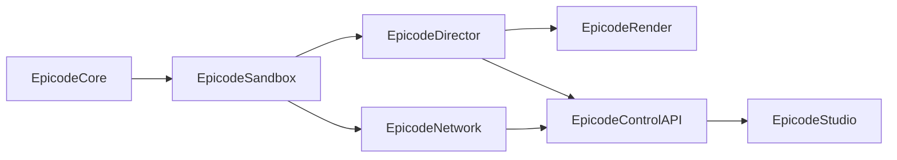

# Design

## Context

现有 Epicode 已经具备场景文档与 Actor 投影、命令注册表、HTTP/WebSocket 控制面、多人会话、角色复制、物品/建造状态和 MRQ 渲染。运行时事件已写入会话目录，但事件只是审计和快照附属物：没有固定 tick、随机种子、检查点、重演或分支语义；导演侧只有会话面板中的入口列表，没有时间轴和叙事图。

当前实现还受以下约束：

- `scene.json` 是作者平面唯一真相源，运行时修改不写回场景。
- `EpicodeNetworkSubsystem` 同时处理会话、角色租约、世界状态和复制，新增沙盒/导演职责前需要拆出稳定边界。
- 控制 API 通过共享命令注册表和参与者令牌执行，新增方法应沿用现有鉴权、幂等、事件和错误模型。
- Linux 无头服务器是权威模拟基线，`-nullrhi` 冒烟不比较像素。
- 现有场景、导入、Agent、Viewer 和渲染命令必须继续可用。

需求见 `specs/sandbox-world/spec.md`、`specs/narrative-direction/spec.md`、`specs/session-replay/spec.md` 和五个修改能力的 delta。动机见 `proposal.md`。

## Goals / Non-Goals

**Goals:**

- 用制作包把“布景、演员、规则、叙事”组合成可运行、可版本化的制作单元。
- 建立独立的确定性沙盒核心，让 UE Actor 和复制层成为投影而不是权威状态。
- 让事件日志成为运行时事实来源，可从检查点 ghost 回看、确定重演和分叉。
- 让导演通过服务器命令干预沙盒，并把干预、节拍、Take 和分支写入同一时间轴。
- 让 Take 从 live 会话中固化，离线 MRQ 渲染不依赖实时世界。
- 保持旧场景会话和现有表演者/Agent/Viewer 路径可用。

**Non-Goals:**

- 不做 MMO 级分片、跨服务器迁移或 Replication Graph 调优。
- 不实现公网多租户、UGC 市场、回滚网络同步（rollback netcode）或完整物理确定性。
- 不替代现有场景编辑器、导入和单用户渲染链路。
- 不在本设计内完成 MetaHuman、完整 IK、音频驱动和 Windows 打包。
- 不保证跨 GPU 的像素级渲染一致，只保证帧数、尺寸和重演状态摘要。

## Decisions

### D1. 制作包是新的作者根，场景继续只描述布景

新增 `production.json`，位于 `Saved/Epicode/Productions/<productionId>/`，包含：

```json
{
  "schemaVersion": 1,
  "productionId": "...",
  "name": "Rooftop Heist",
  "sceneId": "...",
  "cast": [{"slot": "hero", "entityId": "...", "participantKind": "performer"}],
  "worldRules": {"interactionPoints": [], "zones": [], "spawners": [], "resources": [], "budgets": {}},
  "narrative": {"entryBeatId": "beat-1", "variables": {}, "beats": [], "cues": []},
  "cameraPresets": [],
  "extensions": {}
}
```

`scene.json` 继续只负责静态布景、环境、相机和基础实体。制作包负责“谁在这个世界里、能做什么、故事如何推进、从哪个镜头看”。这样避免把叙事图和规则塞进场景 schema，也避免每次沙盒扩展都升级场景版本。旧场景没有制作包时，系统生成仅存在于会话中的默认制作包视图，不写盘。

替代方案是把所有字段并入 `scene.json` v3。它会让单用户场景编辑器承担运行时规则和叙事图，迁移、校验和撤销都会变复杂，且现有导入/渲染路径需要理解无关字段。

### D2. 确定性沙盒核心与 UE 表现层分离

新增 `EpicodeSandbox` 模块，核心对象是 `FEpicodeSandboxWorld`：

- 纯状态与规则：实体、库存、交互点、区域、生成器、NPC 行为、叙事变量和随机流。
- 固定 tick 推进：输入、规则、生成、交互和叙事条件在固定 tick 中执行。
- 输出：领域事件、状态摘要、投影指令。
- 不直接依赖 Actor、Slate 或渲染。

`UEpicodeSandboxSubsystem` 负责生命周期、世界创建/恢复、规则加载和事件分发。`EpicodeNetwork` 继续负责会话参与者、租约、RPC 和 UE 复制，但把世界状态读写委托给沙盒核心；角色和 NPC 的 UE Actor 由投影器根据沙盒状态创建、更新和销毁。

替代方案是继续把物品、建造和演员状态保存在 `FEpicodeWorldState` 并让 Actor 作为权威。它已经导致“会话 JSON + Actor 状态”双真相源，无法可靠重演，也无法在不启动 UE 世界的服务端工具中校验规则。

### D3. 命令是意图，事件是事实

控制 API、导演控制台和游戏 RPC 都提交带参与者、幂等键和期望版本的命令意图。沙盒核心验证后产生领域事件，事件是唯一可重演事实：

- 输入事件：移动、交互、表演、导演 cue、生成、接管、暂停。
- 结果事件：状态变更、目标完成、节拍进入、生成失败、差异检测。
- 系统事件：检查点、重演开始/结束、分支创建、Take 固化。

命令响应只表示“是否接受”以及事件序号；异步结果通过事件和快照查询。Actor 更新、UI 刷新和 WebSocket 推送都订阅事件，不自行推导权威状态。

替代方案是让 Actor 变更直接写日志。Actor 状态包含引擎内部字段和本地表现，不可稳定序列化，也无法保证与规则状态一致。

### D4. 固定 tick、显式随机流和稳定顺序

权威模拟默认以 30 Hz 固定 tick 推进，与现有角色复制频率一致；渲染帧率、网络抖动和本地表现不得改变 tick 结果。随机数使用按域拆分的显式流：

- `spawn`、`loot`、`npc`、`combat`、`narrative` 各自独立种子。
- 每次随机抽取记录流名、序号和结果，重演时消费同一记录。
- 实体、参与者、交互点和生成候选按稳定标识排序，不依赖 `TMap`/哈希迭代顺序。
- 会话开始记录引擎版本、项目版本、规则 schema、内容目录摘要和构建摘要。

替代方案是使用全局 `FMath::Rand` 或墙钟时间。它无法复现，也无法在分叉时隔离不同随机域。

### D5. 事件日志 + 检查点 + 快照摘要

会话目录结构：

```
Saved/Epicode/Sessions/<sessionId>/
  manifest.json
  initial_snapshot.json
  journal.jsonl
  checkpoints/<sequence>.json
  branches/<branchId>/
  takes/<takeId>/<version>/take.json
  audit.jsonl
```

`journal.jsonl` 只追加，每行包含 `sequence`、`tick`、`type`、`actor`、`payload`、`digest` 和可选 `parentSequence`。检查点保存完整沙盒状态、叙事状态、参与者摘要和内容摘要。重演从目标序号之前最近的检查点开始，只重放后续事件。

替代方案是每帧保存完整快照。它会让长会话磁盘和内存不可控，也无法支持细粒度差异检测。

### D6. 重演分为 ghost 与 resim，分叉必须隔离

- **Ghost**：从快照/事件构建只读历史视图，供导演和 Viewer 播放、暂停、跳转；不执行规则，不写日志。
- **Resim**：从检查点重放事件到目标序号，在关键点比较状态摘要；差异时返回首个差异事件和字段。
- **Branch**：以分叉序号为界复制必要快照和日志摘要，创建独立会话目录；父会话不变。

重演在独立工作线程或工作进程中执行，不阻塞 live 会话。版本摘要不一致时默认拒绝精确重演，只有显式 `allowInexact=true` 才返回带警告的近似结果。

替代方案是直接在当前 live 世界上“倒带”。它会破坏参与者连接、复制和导演正在进行的操作，也无法审计。

### D7. 导演是特权命令源，不是第二个模拟器

`EpicodeDirector` 维护叙事图、cue 调度、Take 元数据和导演视图状态，但所有修改都通过 `FEpicodeSandboxWorld` 的命令接口进入同一事件日志。导演能力包括：

- 时间：暂停、恢复、倍率、跳转。
- 世界：生成/移除、环境、目标、cue、节拍。
- 控制：临时接管表演者/Agent/NPC，接管带 lease 和冲突检查。
- 记录：Take 入出点、镜头轨道、备注和版本。
- 视图：live、ghost、resim 和分支选择。

导演 cue 作为事件记录，时间 cue 使用模拟 tick 而不是墙钟。导演接管使用独立 lease，结束接管时恢复原控制策略。

替代方案是让导演直接操作 Actor 或本地状态。它会绕过服务器校验，无法进入事件日志，也无法在重演中复现。

### D8. Take 是不可变时间轴产物

Take 固化以下内容：

- 事件序号范围和初始快照引用。
- 一个或多个镜头轨道（相机、切换事件、帧范围）。
- 分辨率、帧率、输出格式和渲染预设。
- 叙事节拍、导演备注和内容摘要。
- 预期帧数和产物校验规则。

Take 保存后区间和轨道不可原地修改，修改生成新版本。渲染器只读取 Take 产物，不读取 live 会话。渲染输出文件名包含 Take、版本、轨道和帧号，产物登记回 Take 清单。

替代方案是让渲染直接抓取当前会话。它会与 live 输入竞争，无法保证重复渲染一致，也无法在会话结束后补拍。

### D9. API 按领域分组并沿用现有控制面

新增方法族：

- `production.*`：创建、打开、保存、校验、列出、删除。
- `sandbox.*`：规则查询/更新、交互、生成、资源、预算、状态。
- `director.*`：暂停/倍率、cue、接管、目标、节拍、Take 标记。
- `replay.*`：ghost、start、status、cancel、branch、range。
- `take.*`：创建、查询、校验、渲染。

所有修改方法沿用参与者令牌、幂等键、请求标识、状态版本和结构化错误。长时重演返回作业标识，通过 `replay.status` 和 WebSocket 事件报告。事件流增加 `sandbox.*`、`narrative.*`、`director.*`、`replay.*` 和 `take.*` 类别。

替代方案是新增独立 HTTP 服务。它会重复鉴权、幂等和事件基础设施，并让 Studio 需要维护两套客户端。

### D10. 模块依赖与存储边界

模块依赖方向：



- `EpicodeCore`：文档、命令、事件、设置、内容摘要接口。
- `EpicodeSandbox`：制作包、世界规则、确定性世界、日志、检查点、分支。
- `EpicodeNetwork`：参与者、租约、RPC、复制和 Actor 投影适配。
- `EpicodeDirector`：叙事图、cue、接管理、Take、重演调度。
- `EpicodeRender`：Take 到 MRQ 作业的适配。
- `EpicodeControlAPI`：HTTP/WS 方法与事件适配。
- `EpicodeStudio`：制作工作区、沙盒面板和导演工作区。

替代方案是把沙盒和导演都塞进 `EpicodeNetwork`。它会让网络模块承担文件日志、规则校验和 UI 查询，测试和打包边界都会变差。

### D11. 导演工作区与制作工作区分开

制作工作区继续管理场景、角色、道具、灯光、环境和导入；新增沙盒世界面板管理制作包规则。导演工作区作为独立可停靠页签，包含时间轴、节拍图、状态面板、Take 面板和重演传输控件。两者共用命令注册表和错误模型，但布局、刷新频率和权限不同。

时间轴使用增量事件和检查点加载，长会话不一次性构建全部 UI 行。ghost/resim 状态在后台准备，UI 线程单次阻塞不超过 100 ms。

替代方案是把导演控件继续放在多人面板。它无法承载时间轴、节拍图和 Take 版本，且会让普通会话面板承担重型编辑器职责。

### D12. 兼容迁移采用“旧会话适配 + 功能开关”

- 旧 `scene.json` 会话通过适配器创建默认制作包视图，不写盘。
- 旧会话事件继续可读；新日志字段缺失时标记 `replayable=false`，不伪造重演。
- 新能力由 `bEnableSandboxDirector` 和 `bEnableReplay` 配置控制，默认在编辑器/服务器开启，在 Viewer/Agent 客户端按需关闭。
- 现有 `session.*`、`scene.*`、`render.*` 命令继续注册；新命令失败不影响旧路径。
- `EpicodeNetwork` 的世界状态逐步迁移到沙盒核心，迁移期间保留只读适配层。

回滚策略：关闭功能开关恢复旧会话路径；制作包和日志目录保留，不删除作者场景或现有渲染产物。

### D13. 性能、保留和安全预算

- 实体、事件、生成率和导演 cue 都有配置预算；超出时降级并报告，不静默丢事件。
- 日志按检查点边界压缩；保留窗口、检查点间隔和 Take 存储有上限。
- 重演在独立任务中执行，限制并发数；live 会话优先级高于重演。
- 内容路径使用允许根目录校验；导演/重演命令需要 owner 或 director 权限。
- 审计日志记录命令、参与者、结果和事件序号，不记录完整令牌。

替代方案是不限日志、每帧全量快照。它会在长会话中耗尽磁盘和内存。

## Risks / Trade-offs

- **确定性漂移**：浮点、哈希迭代、引擎内部随机或 Actor 更新顺序都可能破坏重演。→ 固定 tick、显式随机流、稳定排序、状态摘要和确定性自动化测试；对不可控引擎行为记录版本并标记非精确。
- **双真相源回归**：沙盒状态、Actor 投影和旧 `EpicodeWorldState` 可能短暂并存。→ 明确沙盒为权威，旧状态只读适配；用投影一致性测试和单一读写入口收敛。
- **导演与演员自主冲突**：接管、暂停和 cue 可能覆盖玩家/Agent 输入。→ 接管 lease、优先级、冲突错误和审计；恢复时保留接管结束状态。
- **日志和重演性能**：长会话、分支和 Take 会放大存储与 CPU。→ 检查点、压缩、预算、独立重演线程和保留窗口。
- **渲染输入漂移**：Take 依赖的相机、快照或内容变化会导致渲染与录制不一致。→ Take 不可变、内容摘要校验、默认拒绝非精确渲染。
- **UI 复杂度**：时间轴和节拍图容易阻塞编辑器。→ 增量加载、后台准备、分页事件和 100 ms 响应预算。
- **范围膨胀**：沙盒、叙事、重演和 Take 同时落地风险高。→ 按制作包 → 沙盒核心 → 日志/重演 → 导演 → Take/渲染分阶段，每阶段保留可运行回退。

## Migration Plan

1. 引入 `production.json`、制作包库和默认兼容视图；旧场景可创建制作包但不强制迁移。
2. 引入 `EpicodeSandbox` 固定 tick、规则校验、事件日志和投影适配；旧会话通过适配器继续运行。
3. 引入检查点、ghost、resim 和分支；先用只读会话验证，再接入导演命令。
4. 引入 `EpicodeDirector` 叙事图、cue、接管、Take 和导演工作区；通过功能开关灰度启用。
5. 接入 `production.*`/`sandbox.*`/`director.*`/`replay.*`/`take.*` API、事件流和 Take 渲染。
6. 补齐 `Director.sh`、`ReplaySmoke.sh`、确定性测试、干净构建和现有 Agent/Viewer/Network 冒烟回归。

任何阶段失败都可以关闭新功能开关回到旧会话路径；制作包、日志和 Take 目录保留用于诊断，不覆盖作者场景或现有渲染产物。
