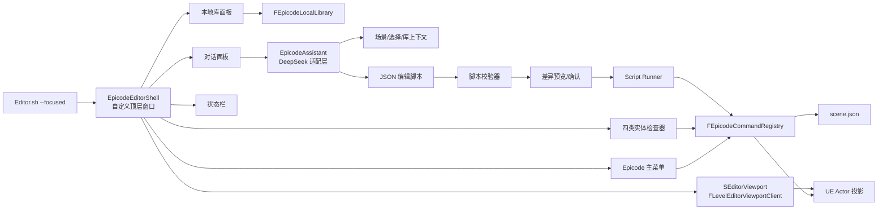

# Design

## Context

Epicode 当前以 Unreal Editor 扩展的形式运行：`Scripts/Editor.sh` 启动完整 `UnrealEditor`，`EpicodeStudio` 在其中注册 nomad 页签。场景真相源是 `Saved/Epicode/Scenes/<sceneId>/scene.json`，UE Actor 是投影，所有写操作经过 `FEpicodeCommandRegistry`。现有 Studio 已覆盖场景、大纲、角色、道具、灯光、环境、导入、渲染和 API 九个页签，但默认界面仍是 Unreal 的完整编辑器。

本设计把默认 Editor 变成一个聚焦的 Epicode 工作台：保留 UE 的场景渲染视口、选择、变换 gizmo 和编辑器世界，隐藏通用编辑器外壳；交互编辑只允许角色、物品、灯光、摄像四类实体的放置、位置/旋转/缩放调整、属性调整和从场景删除。主菜单按 Epicode 能力组织，并增加一个对话窗口，通过 DeepSeek Harness SDK 生成受约束的编辑脚本。

核心约束：

- 不修改 `/usr/local/unreal`，不 fork Unreal Editor。
- 场景 JSON 仍是唯一事实源；UI、对话脚本和 API 使用同一套命令。
- 生成式模型不得直接执行任意代码、控制台命令或文件操作。
- 所有 AI 修改必须可预览、可拒绝、可一次撤销、可审计。
- 本地库只读取配置根目录，不上传资产、不自动下载资产。
- Linux x86_64 + UE 5.8.4 为首要目标。

## Goals / Non-Goals

**Goals:**

- 默认启动一个视觉上只有 Epicode 工作台的 Editor 窗口。
- 保留 `SEditorViewport` / `FLevelEditorViewportClient` 级别的场景渲染和 gizmo 交互。
- 把可见交互限定在四类实体和本地库，不暴露通用编辑器功能。
- 提供与 Epicode Studio 能力对应的主菜单和最小属性检查器。
- 提供对话窗口，把自然语言转换成可校验、可预览、可撤销的 JSON 编辑脚本。
- 为 DeepSeek Harness SDK 提供隔离适配层，允许 SDK、sidecar 或 HTTP 后端替换。
- 保持离线可用：对话后端不可用时，手工编辑和本地库仍然工作。

**Non-Goals:**

- 不实现新的渲染器、路径追踪器或视频编码器。
- 不删除 Unreal Engine 的底层模块；只做界面级隐藏和入口限制。
- 不实现完整 Content Browser、资产编辑器、蓝图、材质图、Sequencer、地形、植被、PIE、渲染队列、插件浏览器或项目设置。
- 不做云端资产库、资产市场、自动购买或自动下载。
- 不做模型微调、训练或本地大模型推理。
- 不允许模型输出 Python/Lua/控制台命令并直接执行。
- 不做多用户协同对话或远程共享会话。

## Architecture Overview



### Module layout

| 模块 | 类型 | 职责 |
| --- | --- | --- |
| `EpicodeEditorShell` | Editor | 聚焦顶层窗口、主菜单、视口宿主、库/检查器/对话/状态栏布局、默认页签隐藏、快捷键限制、旧版兼容开关 |
| `EpicodeAssistant` | Editor | 对话模型、消息历史、流式回复、DeepSeek 适配、上下文构建、脚本生成、预览/确认 UI |
| `EpicodeCore` | Runtime | 现有场景命令、实体投影、事务、撤销；新增编辑脚本校验器和执行器 |
| `EpicodeImport` | Editor | 现有 Interchange 导入；新增本地库索引、扫描、导入、删除和元数据 |
| `EpicodeStudio` | Editor | 旧九页签兼容模式；聚焦模式下只保留必要的底层服务，不注册默认主页签 |

### Launch flow

```text
Editor.sh
  -> parse --focused (default) / --legacy
  -> UnrealEditor <project> -EpicodeFocusedEditor
  -> EpicodeEditorShell StartupModule
  -> after engine init:
       hide stock editor main window
       create Epicode shell window
       attach viewport to current editor world
       restore last scene or show empty state
  -> on exit: close shell, restore/hide stock window, save layout
```

`--legacy` 直接走现有 `UnrealEditor` 启动路径，不创建聚焦外壳，保留完整 Editor 和九页签 Studio。

## Decisions

### D1. 聚焦外壳使用自定义顶层窗口，而不是删除引擎功能

Unreal Editor 的主界面不是单一可替换控件。可行方案有三类：

1. **自定义顶层 `SWindow` + `SEditorViewport` + `FLevelEditorViewportClient`**（首选）。
   - 启动后隐藏 `GEditor` 的 stock main frame，创建 Epicode 自己的 `SWindow`。
   - 视口使用 `SEditorViewport` 承载 `FLevelEditorViewportClient`，复用 UE 的选择、gizmo、网格、视图模式和实时渲染。
   - 菜单、库、检查器、对话和状态栏都是自定义 Slate 控件。
   - 优点：视觉上完全脱离 stock 编辑器；保留编辑器的世界和 gizmo。
   - 风险：需要验证 UE 5.8 的 `FLevelEditorViewportClient` 构造、输入路由、编辑器世界生命周期和退出顺序。

2. **全屏 nomad 页签 + 视口重挂接**（回退）。
   - 注册一个全屏 `EpicodeFocusedEditor` nomad 页签，内部承载 `SLevelViewport` 和自定义控件。
   - 关闭其他页签，隐藏菜单栏/工具栏/状态栏。
   - 优点：实现成本低，复用 Level Editor 现有视口。
   - 风险：stock 菜单/工具栏/页签可能仍可通过快捷键或边缘入口出现，需要额外的输入和菜单拦截。

3. **`-game` + 自定义视口/gizmo**（最后回退）。
   - 不启动 Editor UI，使用自定义 Slate/UMG 视口和自研选择/变换 gizmo。
   - 优点：完全可控。
   - 风险：失去 Editor 的 gizmo、选择、撤销和资产编辑能力，成本最高。不作为首选。

**决策**：先做 D1 方案 1 的 spike；如果 5.8 的视口构造或世界生命周期不可行，退回方案 2。方案 3 只作为明确失败后的备选，不在本变更默认路径。

**PoC 结果（2026-11-15，UE 5.8.4）**：方案 1 可行，采用 `SWindow + SLevelViewport + FLevelEditorViewportClient`。`SLevelViewport` 承载 stock Level Editor 视口客户端，因此选择、变换 gizmo、网格和撤销都复用引擎实现。PoC 发现并处理了四个 5.8 限制：

- `OnEditorInitialized` 早于 `FLevelEditorModule::GetFirstLevelEditor()` 可用；模块用 0.1 秒 ticker 重试，最多 30 秒，不静默回退 stock 界面。
- 独立 `SLevelViewport` 没有 `ParentLayout` 时，`SLevelViewport::IsInForegroundTab()` 返回 false，视口不会持续 tick；聚焦视口子类覆盖 `IsVisible()` 走 `SEditorViewport::IsVisible()`。
- UE 5.8 默认使用新 TRS gizmo，但独立视口没有可用的 active editor gizmo，legacy widget 又因 `AreEditorGizmosAllowed()` 为真而不绘制。聚焦模式在 `OnEditorPreExit` 前临时设置 `GLevelEditorModeTools().SetSupportsViewportITF(false)`，强制 legacy transform widget；退出前恢复原值。该设置只影响当前进程的聚焦模式，不修改 `--legacy`，也不写配置。
- stock 主窗口用 `SWindow::HideWindow()` 隐藏而不是销毁；关闭聚焦窗口时恢复 stock 窗口。`SupportsViewportITF` 必须在 `FEditorDelegates::OnEditorPreExit` 恢复，不能在 `ShutdownModule` 里调用 `GLevelEditorModeTools()`，否则模块卸载顺序会触发 ensure。

PoC 证据：`Saved/Logs/editor-shell-poc.log`、`Saved/Screenshots/EditorShellPoC-translate.png`、`-rotate.png`、`-scale.png`。选择 `PlayerStart0` 后，移动/旋转/缩放 gizmo 均可见；事务移动后 `GEditor->UndoTransaction()` 将位置从 `(154.656, 79.013, 208.000)` 恢复到 `(54.656, 79.013, 208.000)`，`pass=true`；关闭聚焦窗口后 stock 编辑器恢复并进程退出，无残留。

### D2. “删除通用功能”是界面级移除，不是引擎级删除

不 fork 引擎的前提下，无法真正移除 Unreal Editor 的模块和底层功能。实现采用：

- 隐藏 stock main frame、菜单栏、工具栏、主标签、状态栏和默认窗口。
- 关闭/不注册 Content Browser、Details、World Settings、Blueprint Editor、Material Editor、Sequencer、Output Log 等默认页签。
- 拦截并禁用通用快捷键：Content Browser、Blueprint、Sequencer、PIE、Simulate、Build、Source Control、插件/项目设置等。
- 只保留 Epicode 菜单和必要快捷键：选择、移动、旋转、缩放、删除、撤销/重做、保存、聚焦、框选。
- 提供 `--legacy` 维护入口，保留完整 Editor；它不是日常产品界面。
- 在文档和诊断中明确：通用功能仍在底层，只是不可从聚焦界面进入。

### D3. 主菜单按 Epicode Studio 能力组织

| 菜单 | 内容 |
| --- | --- |
| 场景 | 新建、打开、保存、另存为、关闭、最近场景；从本地库导入场景；从本地库删除场景 |
| 角色 | 从本地库放置角色；导入角色到本地库；从本地库删除角色；删除选中角色 |
| 物品 | 从本地库放置物品；导入物品到本地库；从本地库删除物品；删除选中物品 |
| 灯光 | 放置方向光、点光、聚光灯、矩形光；删除选中灯光 |
| 摄像 | 放置相机；设为活动相机；删除选中相机 |
| 本地库 | 场景库、角色库、物品库的浏览/搜索/刷新/定位；导入；删除 |
| 编辑 | 撤销、重做、选择、移动、旋转、缩放、删除、复制变换？ |
| 视图 | Lit/Unlit/Wireframe、网格、显示标志、聚焦选中、框选全部、相机速度 |
| 对话 | 显示/隐藏对话、新建会话、清空、重试、设置 |
| 帮助 | 快捷键、关于、诊断信息 |

不放入主菜单：环境、渲染队列、API 状态、Content Browser、蓝图、材质、Sequencer、地形、植被、PIE、插件、项目设置。旧 Studio 的 Environment/Render/API 页签只在 `--legacy` 保留。

### D4. 只保留四类实体的最小编辑面

允许：

- **放置**：从本地库放置角色/物品；从菜单放置灯光/相机。
- **选择**：视口点选、框选、最小对象列表选择。
- **变换**：移动、旋转、缩放；世界/局部坐标；网格吸附；数值输入。
- **属性**：
  - 角色：骨骼网格、动画、播放/暂停、动画速度、可见性。
  - 物品：静态网格、材质槽覆盖、物理开关、可见性。
  - 灯光：类型、强度、颜色、衰减、阴影开关。
  - 摄像：视场角、焦距、光圈、对焦距离、活动相机。
- **删除**：从当前场景删除；不删除源资产。
- **撤销/重做**：所有编辑通过命令注册表和编辑器事务。

不允许：层级重挂接、分组、复制实体（除非后续明确需要）、环境编辑、材质图、蓝图、动画蓝图、Sequencer、地形、植被、物理约束、导航、PIE、渲染队列、通用资产导入器 UI。

最小对象列表只用于选择和管理当前场景中的四类实体；它不是完整 Outliner，不提供层级拖放、批量重挂接或任意 Actor 编辑。

### D5. 本地库是索引 + 受控导入，不是 Content Browser

本地库由三部分组成：

| 库 | 来源 | 默认根 |
| --- | --- | --- |
| 场景库 | Epicode `scene.json` | `Saved/Epicode/Scenes` |
| 角色库 | 骨骼网格资产 | `/Game/Epicode/Imported/Characters` + 配置根 |
| 物品库 | 静态网格资产 | `/Game/Epicode/Imported/Props` + 配置根 |

索引写入 `Saved/Epicode/Library/index.json`，条目包含：

- `id`、`kind`、`name`、`assetPath`、`sourcePath`、`sourceHash`、`tags`、`thumbnailPath`、`createdAt`、`updatedAt`。
- 场景条目额外包含 `sceneId`、`levelPath`、`entityCount`、`modifiedAt`。
- 索引是缓存，不是真相源；启动时可从资产注册表和场景库重建。

导入：

- 场景：读取 `.json` 场景文件，校验 schema，复制/写入 `Saved/Epicode/Scenes/<sceneId>/scene.json`，或通过 `scene.open` + `scene.saveAs` 导入。
- 角色：走现有 Interchange 导入，目标 `/Game/Epicode/Imported/Characters/<name>`，要求包含骨骼网格；否则拒绝并提示改用物品。
- 物品：走现有 Interchange/OBJ 导入，目标 `/Game/Epicode/Imported/Props/<name>`，要求静态网格。
- 导入期间显示任务进度，不阻塞 UI；失败保留源文件，不留下半成品条目。

删除：

- 场景：调用 `scene.delete` 移入 `Saved/Epicode/Trash/Scenes/<timestamp>/`，不永久删除。
- 角色/物品：默认只移除库索引条目，不删除 `.uasset`；如果用户显式勾选“同时删除资产文件”，二次确认后删除，并检查引用。
- 删除当前打开的场景或正在被场景引用的资产时拒绝，并显示引用原因。

放置：

- 角色/物品从库拖到视口或点击“放置”，在视口中心或鼠标位置生成实体。
- 灯光/相机从菜单放置，使用默认参数。
- 放置后自动选中，并进入移动模式。

### D6. 对话后端使用 Python sidecar，DeepSeek Harness SDK 不直接耦合 UI

已确认 DeepSeek Harness SDK 是 Python 包 `deepseek-harness-sdk`，不是 C++ 库。Unreal Editor 不应直接嵌入 Python 解释器：PythonScriptPlugin 未默认启用，直接把第三方包加载进 Editor 会增加 ABI、GIL、崩溃隔离和打包风险。因此采用 **Python sidecar + C++ 客户端**：

```text
Unreal EpicodeAssistant
  <-> stdio JSONL（默认）或 127.0.0.1 HTTP
  <-> Scripts/Assistant/DeepSeekHarnessSidecar.py
  <-> deepseek-harness-sdk（隔离 venv）
  <-> DeepSeek 服务
```

定义 C++ 侧 `IConversationBackend`：

```cpp
class IConversationStream
{
public:
    virtual void Cancel() = 0;
    virtual bool IsDone() const = 0;
    virtual void Poll(TArray<FConversationEvent>& OutEvents) = 0;
};

class IConversationBackend
{
public:
    virtual ~IConversationBackend() = default;
    virtual TSharedPtr<IConversationStream> Start(
        const FConversationRequest& Request, FString& OutError) = 0;
    virtual bool IsAvailable(FString& OutError) const = 0;
};
```

实现采用可轮询流而不是回调：网络/HTTP 线程只把字节写入队列，UI 在 Tick 中调用 `Poll`，避免跨线程 Slate 更新。`FOpenAICompatibleChatBackend` 已按此接口实现 HTTP/SSE 降级。

实现：

- `FDeepSeekHarnessSidecarBackend`（默认）：Unreal 启动/复用一个 Python sidecar 子进程，通过 `FPlatformProcess` 管道发送 JSONL 请求，读取流式事件；sidecar 崩溃时只影响对话，不影响视口和手工编辑。
- sidecar 入口：`Scripts/Assistant/DeepSeekHarnessSidecar.py`；依赖：`Scripts/Assistant/requirements.txt`，固定 `deepseek-harness-sdk==<version>`。
- 隔离环境：优先使用 `Saved/Epicode/Assistant/venv` 或 `Scripts/Assistant/.venv`，不把 venv 提交仓库；安装失败时显示 pip 输出摘要和修复命令。
- SDK 来源：公开 PyPI 当前查不到 `deepseek-harness-sdk`，需要用户提供私有索引 URL、凭据或 wheel。实现任务在拿到来源前保持待定，不把包二进制提交仓库。
- sidecar 协议（JSONL）：
  - Unreal -> sidecar：`{"id":1,"op":"chat","messages":[...],"context":{...}}`、`{"id":1,"op":"cancel"}`、`{"op":"ping"}`、`{"op":"shutdown"}`。
  - sidecar -> Unreal：`{"id":1,"event":"delta","text":"..."}`、`{"event":"tool","name":"...","args":{...}}`、`{"id":1,"event":"done","usage":{...}}`、`{"id":1,"event":"error","code":"...","message":"..."}`。
  - 每行一个 JSON 对象，UTF-8；单行上限 1 MB；未知事件忽略并记录一次警告。
- 可选 HTTP 模式：sidecar 可监听 `127.0.0.1:8720`，提供 `/health`、`/v1/chat`（SSE）、`/v1/cancel`，使用 `Saved/Epicode/assistant-token`（0600）做本地鉴权。默认仍用 stdio，避免端口冲突和防火墙问题。
- `FOpenAICompatibleChatBackend` 作为降级：当 sidecar/SDK 不可用时，可直接调用 DeepSeek 的 OpenAI 兼容 HTTP API；它也实现同一接口，便于对照测试。
- `FMockConversationBackend`：自动化测试使用，不依赖网络和 SDK。

配置：

```ini
[/Script/EpicodeAssistant.EpicodeAssistantSettings]
bEnabled=true
Backend=deepseek-harness-sidecar
SidecarCommand=python3
SidecarScript=Scripts/Assistant/DeepSeekHarnessSidecar.py
SidecarMode=stdio
Endpoint=
Model=deepseek-chat
ApiKeyFile=Saved/Epicode/deepseek.env
MaxContextTokens=32000
MaxRepairAttempts=2
RequestTimeoutSeconds=120
SidecarIdleSeconds=300
```

密钥只从环境变量或 `Saved/Epicode/deepseek.env`（0600）读取；sidecar 继承受控环境，不把密钥写入命令行参数。日志、错误、审计只记录后端名、模型名和耗时，不记录密钥或完整 prompt 中的敏感内容。

### D7. 对话只生成编辑脚本，不执行任意代码

模型输出必须是单个 JSON 对象，包在 ```json 代码块或纯 JSON 中：

```json
{
  "schemaVersion": 1,
  "summary": "在主街放置一名角色并把相机对准他",
  "requiresConfirmation": true,
  "operations": [
    {
      "clientId": "hero",
      "method": "character.spawn",
      "params": {
        "name": "Hero",
        "skeletalMesh": "/Game/Epicode/Imported/Characters/Hero/Hero"
      }
    },
    {
      "clientId": "hero-transform",
      "method": "entity.setTransform",
      "params": {
        "id": "$hero",
        "transform": {
          "location": [0, 0, 100],
          "rotation": [0, 0, 0],
          "scale": [1, 1, 1]
        }
      }
    },
    {
      "clientId": "camera",
      "method": "camera.create",
      "params": {
        "name": "ShotCam",
        "fieldOfView": 35
      }
    }
  ]
}
```

规则：

- `schemaVersion` 必须匹配支持版本。
- `operations` 最多 50 条；总影响实体最多 100 个。
- `method` 必须在白名单内：`character.spawn`、`character.bind`、`character.play`、`character.pause`、`character.setSpeed`、`character.setMaterial`、`prop.spawn`、`prop.create`、`prop.setMaterial`、`prop.resetMaterial`、`prop.setPhysics`、`light.create`、`light.update`、`light.delete`、`camera.create`、`camera.update`、`camera.activate`、`camera.delete`、`entity.setTransform`、`entity.setVisible`、`entity.rename`、`entity.delete`、`entity.duplicate`、`scene.save`。
- 禁止 `scene.transaction` 嵌套、`import.*`、`render.*`、`system.*`、`director.*`、`sandbox.*`、任意控制台/Python/Lua/文件/网络命令。
- `$clientId` 只能引用同一脚本中更早的 `clientId`；解析失败不应用。
- 资产路径必须以 `/Game/` 开头，且存在或出现在本地库索引中；外部路径拒绝。
- 删除、批量删除、覆盖已有实体、修改活动相机等操作默认 `requiresConfirmation=true`。
- 空操作、纯问答、无法解析为脚本时，对话只显示文本，不修改场景。

### D8. 脚本校验、预览、应用和撤销是单事务闭环

流程：

```text
用户消息
  -> 后端流式回复
  -> 提取 JSON 脚本
  -> schema 校验
  -> 方法白名单
  -> 参数类型/范围校验
  -> 资产存在性/路径校验
  -> $clientId 引用解析
  -> 生成差异预览（新建/修改/删除/警告）
  -> 用户在对话窗口点击“应用”
  -> scene.transaction 单事务执行
  -> 失败：回滚，显示领域错误
  -> 成功：一次撤销恢复全部修改，写审计日志
```

实现：

- `script.validate`：只校验，不修改场景，返回规范化脚本、影响实体、警告和错误。
- `script.apply`：重新校验后，在一个 `scene.transaction` 中执行；每个 operation 结果写入 `clientId -> entityId` 映射。
- 预览面板显示：新建实体数量、修改实体及字段、删除实体、资产路径、潜在不可逆操作。
- 破坏性操作必须二次确认；用户拒绝时不执行。
- 应用成功或失败后写入 `Saved/Epicode/Script/audit.jsonl`：时间、会话 ID、模型、后端、脚本摘要、operation 数、受影响实体数、结果、错误码、耗时、是否确认；使用 condensed JSON 单行追加，不记录密钥或完整脚本正文。
- 撤销使用现有编辑器事务；一次 `Ctrl+Z` 恢复整个脚本，而不是逐条恢复。
- 如果执行中某条失败，事务回滚，已创建实体不残留。
- 校验实际覆盖：schema 版本、`summary` 长度、operation 数量、clientId 格式/重复/前向引用、方法白名单、实体存在性、transform 有限值与正缩放、灯光类型/锥角、相机 FOV、名称长度、速度范围、资产路径 `/Game/` 前缀与包存在性；删除和 `camera.activate` 自动要求确认。
- `script.apply` 对每条 operation 解析 `$clientId` 后调用同一命令注册表，子命令使用 `bUndoable=false` 防止逐条事务；整个脚本只包一层事务。
- 实现位于 `engine/Plugins/EpicodeAssistant/Source/EpicodeAssistant/Public/EpicodeScript.h` 与 `Private/EpicodeScript.cpp`，模块启动时向命令注册表注册 `script.validate`/`script.apply`。

### D9. 上下文构建要小而准

发送给模型的内容：

- 当前场景摘要：`sceneId`、名称、`levelPath`、实体数量、四类实体列表（ID、名称、类型、变换、关键属性）。
- 当前选择：实体 ID、类型、名称、变换、属性。
- 本地库摘要：场景列表、角色列表、物品列表的名称、路径、标签；不发送缩略图二进制。
- 命令 schema：允许的方法、参数类型、单位、坐标约定、示例。
- 约束：不修改环境/渲染/网络/文件；不删除库资产；不创建不在库中的资产；最多操作数。
- 用户消息和最近 N 轮对话。

不发送：

- API 令牌、DeepSeek 密钥、文件系统路径（除库路径的 `assetPath`）、完整 `.uasset`/贴图/网格二进制。
- 未选择的私有数据、其他会话数据。

上下文超出预算时，优先保留当前场景/选择/命令 schema，裁剪历史对话和库列表；裁剪发生在本地，不把超限内容发给模型。

### D10. 旧版兼容和迁移

- `Editor.sh` 默认加 `-EpicodeFocusedEditor`；`--legacy` 不加。
- 聚焦模式下 `EpicodeStudio` 默认不注册九页签，只保留底层服务；`--legacy` 注册现有页签。
- 旧 Studio 的 Environment/Render/API 不作为聚焦菜单项；需要时通过 `--legacy` 使用。
- 主 specs 的 `production-ui` 用 MODIFIED 记录默认模式切换；旧需求保留为 legacy 行为。
- 本变更不删除旧代码；先保证聚焦模式稳定，再在后续变更归档旧 UI。

## 聚焦工作台实施结果

2026-11-16 已完成 2.1–2.9（含 2.3 场景文件导入和 2.4 角色/物品本地库）、3.1–3.7 以及 4.1–4.11（本地库索引、扫描、面板、场景导入、资产导入、引用删除、拖放放置、路径安全、冲突处理和测试覆盖）；2026-11-17 继续完成 5.1–5.2、5.7–5.13 的对话接口、模块、Mock 后端、OpenAI 兼容 HTTP/SSE 降级、配置、密钥、上下文、历史和降级。DeepSeek sidecar（5.3–5.6）仍等待 SDK 安装来源；HTTP 降级可直接使用 DeepSeek API。CLI smoke 和正式 automation 测试均已覆盖。实现仍坚持“界面级隐藏、复用命令注册表、保留 `--legacy`”的约束。

### 布局与面板

- 根控件使用垂直 `SVerticalBox`：顶部菜单栏、中间 `SSplitter` 三栏、底部状态栏。
- 左栏包含对象列表、搜索框、类型过滤按钮、资源库列表、本地库场景列表和新场景名输入；右栏上半部分是四类实体检查器，下半部分是对话历史、输入框、发送/停止按钮、后端状态和设置入口。
- 左右栏折叠通过 `SSplitter::Slot` 的动态 `Value`/`MinSize` 加 `SBox::Visibility` 实现；中间视口使用 `Value = 1 - left - right` 自动扩展。
- 面板宽度、折叠状态、最近场景 ID 和视口镜头写入 `Saved/Epicode/Editor/layout.json`。使用 `FJsonSerializer` 读写，槽位 `OnSlotResized` 标脏，`Tick` 节流 0.5 秒保存，析构时再保存一次。
- 视口镜头通过 `FLevelEditorViewportClient::GetViewLocation/GetViewRotation` 读取，启动时 `SetViewLocation/SetViewRotation` 恢复；相机速度使用 UE 5.8 的 `FEditorViewportCameraSpeedSettings` 新 API，避免已废弃的整数设置接口。

### 菜单与对象

- 菜单固定为场景、角色、物品、灯光、摄像、本地库、编辑、视图、对话、帮助；不注册环境、渲染、API、Content Browser、蓝图、材质、Sequencer、地形、植被、PIE、插件和项目设置入口。
- 场景菜单：新建、打开、最近场景、保存、另存为、关闭；最近场景按 `layout.json` 的顺序优先，场景删除走 `scene.delete` 回收站并二次确认。
- 灯光菜单：点光、聚光、方向光、矩形光，调用 `light.create`；摄像菜单创建/激活/删除相机。
- 角色/物品菜单：从本地库放置、从文件导入到本地库、从本地库删除（只移除索引）、删除选中实体。放置调用 `character.spawn`/`prop.spawn`，自动选中并切到移动模式；删除索引写入 `Saved/Epicode/Editor/asset-library.json`，不删除 `.uasset`，并可从本地库菜单恢复。
- 对象列表通过 `entity.list`/`FEpicodeSceneSubsystem::GetDocument` 的数据展示，支持名称搜索和类型过滤；选择写回 `GEditor` 与 `SEditorViewport`，视口选择每 0.25 秒同步回列表。
- 所有写操作走 `FEpicodeEngineSubsystem::ExecuteCommand`，不直接改 Actor；命令成功后刷新模型、列表和状态栏。

### 场景文件导入与本地库资产

- 场景菜单“从文件导入场景...”用 `IDesktopPlatform::OpenFileDialog` 选择 `*.json`，先经 `FEpicodeSceneLibrary::Load` 完成 schema/实体/运行时引用校验并补全空 `sceneId`/`name`，再写入场景库；重复 `sceneId` 用“是=覆盖 / 否=另存副本 / 取消=不导入”三选一，副本生成新 GUID 并追加“（副本）”名称，导入后在场景库高亮选中、标记最近场景并询问是否打开。
- 角色/物品菜单“导入角色/物品到本地库...”用文件对话框选择 FBX/GLTF/GLB 或 FBX/OBJ/GLTF/GLB，提交 `import.submit`（`autoPlace=false`）生成后台任务；左栏资源库标题下方显示导入卡，包含文件名、阶段（排队中/导入中/完成/失败/已取消）、百分比、进度条和“取消导入”按钮。
- Shell 每 0.25 秒通过 `import.status` 轮询任务，不把导入状态混入命令消息；任务成功后用 `UPackage::SavePackage` 把 Interchange 生成的所有资产包写入 `Content/Epicode/Imported/{character,prop}/`，避免只存在于内存、重启后库为空。
- 导入任务即使 `autoPlace=false` 仍会为当前场景创建实体；成功、失败或取消后统一用返回的 `entityIds` 调用 `entity.delete` 清理这些实体，若导入前场景是干净的再 `scene.save` 恢复干净标记，保证“导入到库”不会意外改场景。保存失败时同样回滚场景实体，并在状态栏和对话区显示错误。
- 资源库通过 `FAssetRegistryModule` 递归扫描 `UEpicodeSettings::ImportContentRoot`（默认 `/Game/Epicode/Imported`），`USkeletalMesh` 标为角色、`UStaticMesh` 标为物品，按名称排序。列表项单击放置，菜单也可按类型展开资产子菜单。
- “从本地库删除角色/物品”只把资产路径加入 `Saved/Epicode/Editor/asset-library.json` 的 `hidden` 数组并刷新列表；资产文件和引用它的场景实体保持不变；“本地库 > 恢复隐藏资源”清空该数组。

### 四类实体检查器与数值变换

- 右栏检查器在选中实体时按类型重建：通用名称/可见性；角色骨骼网格、动画路径、循环、播放/暂停、速度；物品静态网格、物理开关、材质槽覆盖；灯光类型、强度、RGB 颜色、阴影、衰减和聚光外锥角；摄像视场角、焦距、光圈、对焦距离和活动相机。
- 所有检查器写操作走命令注册表：名称 `entity.rename`、可见性 `entity.setVisible`、变换 `entity.setTransform`、角色 `character.play/pause/setSpeed`、物品 `prop.setPhysics/setMaterial/resetMaterial`、灯光 `light.update`、摄像 `camera.update/activate`。
- 变换区提供位置/旋转/缩放数值框、局部/世界切换和吸附开关。吸附使用 `GEditor->GetGridSize()` 吸附位置，旋转按 15 度；世界坐标从 Actor 读取并通过 `worldSpace=true` 写回，局部坐标直接编辑文档变换。
- 只有检查器签名（场景 revision、选择、活动相机、坐标空间、吸附）变化时才重建控件，避免 0.25 秒刷新周期抢走 SpinBox/文本框焦点。

### 本地库索引与面板（4.1–4.4）

- `FEpicodeLocalLibrary` 把场景、角色、物品统一写成 `Saved/Epicode/Library/index.json`，schema 版本为 1；条目包含 id、type、name、path、levelPath、entityCount、modifiedAt、available、error 和 tags。
- 索引写入使用 `index.json.tmp` 临时文件再替换；索引缺失时自动重建，JSON 损坏、schema 不兼容或缺少 entries 时先备份为 `index.json.corrupt-<ticks>.json`，再重建并保留警告。
- 场景条目来自 `FEpicodeSceneSubsystem::ListScenes()`，并读取 `scene.json` 补全 `levelPath` 和实体数；不可用场景保留错误信息。
- 角色/物品通过 `FAssetRegistryModule` 在 `UEpicodeSettings::ImportContentRoot` 下递归扫描，按 `USkeletalMesh`/`UStaticMesh` 分类；刷新时保留上次索引中已消失的资产并标记 `available=false`，不静默丢弃。
- 左栏场景列表显示名称、短 sceneId、实体数和修改时间，tooltip 显示完整 sceneId、levelPath、实体数、修改时间和可用状态；资源库对缺失资产显示“缺失”，禁用放置，但仍可从删除菜单移除索引。
- 资源库和场景库各有搜索框与标签过滤框；资源库提供全部/角色/物品分类，两个库的标题行都有刷新按钮，每条资产/场景都有“定位”按钮在文件管理器中打开目录。过滤结果为空时显示“没有匹配…”提示，不可用条目保留在列表中并标记。

### 资产导入进度与取消（4.6）

- `SEpicodeFocusedShell::StartAssetImport` 记录导入前的场景干净状态，提交 `import.submit` 后把 `jobId`、源文件、类型、阶段和进度保存在 Shell；`RefreshUi` 每 0.25 秒调用 `PollAssetImport`，通过新增的 `FEpicodeFocusedShellModel::QueryCommand` 静默查询 `import.status`，避免状态轮询产生命令消息。
- 导入卡由 `SProgressBar` 和取消按钮构成，阶段文本映射 `queued`/`importing`/`done`/`failed`/`cancelled`；同一时间只允许一个待处理任务，重复提交会提示先完成或取消。
- `FinishAssetImport` 统一处理三种终态：成功时保存资产包、删除临时实体、刷新资源库并写入对话；失败时显示 `errorMessage` 并删除临时实体；取消时清空任务并删除临时实体。若导入前场景干净，成功后再次 `scene.save`，失败/取消也尽量恢复干净状态。
- 取消通过 `import.cancel` 请求服务取消；由于 Interchange 调用发生在服务 Tick 内，取消对尚未开始的排队任务立即生效，对已经进入同步导入的任务只能在本次调用结束后清理。进度阶段因此是粗粒度的 `queued(0%) -> importing(10%) -> done(100%)`。

### 库删除与引用检查（4.7）

- 场景删除仍走 `scene.delete` 回收站；角色/物品菜单保留“从本地库移除索引”，写入 `Saved/Epicode/Editor/asset-library.json` 的 `hidden` 数组，不删除资产文件。
- 每个资源库条目额外提供“删除文件”：先检查当前场景文档和所有已保存 `scene.json` 中的 `staticMesh`/`skeletalMesh` 引用；命中时列出场景和实体名称并拒绝删除，场景读取失败也按不可安全删除处理。
- 无引用时用 `ObjectTools::DeleteSingleObject` 删除资产对象，并确保 `.uasset` 文件被移除，再调用 `FEpicodeFocusedShellModel::RemoveAssetEntry` 删除索引条目、清理隐藏集合和刷新资源库；删除成功写入对话区。
- 引用检查以包路径归一化后比较，避免 `Asset.Asset` 与包路径写法差异导致漏检。

### 拖放放置（4.8）

- 资源库行按钮通过 `SButton::OnSlateButtonDragDetected` 启动 `FEpicodeAssetDragDropOp`，拖拽装饰器显示资产短名；单击仍走原放置路径。
- 视口及其失败页统一包在 `SDropTarget` 中，`OnAllowDrop` 只接受资产拖拽操作；`OnDropped` 读取拖拽携带的资产路径和类型，调用 `character.spawn`/`prop.spawn`。
- 落点使用 `FLevelEditorViewportClient::GetCursorWorldLocationFromMousePos` 取得鼠标射线，与 `Z=0` 平面求交；交点过近、过远或射线平行地面时退回相机前方 400cm，避免放置到相机后方或无穷远。
- `PlaceAsset` 接受可选落点覆盖，保持自动选中和切到移动模式；测试通过 `PlaceAssetAtForSmokeTest` 验证显式坐标落点。

### 路径安全（4.9）

- `FEpicodeImportService::ValidateRequest` 依次检查文件存在、非空、`MaxImportBytes`、扩展名、`.umap` 拒绝、源路径位于 `ImportRoots`、目标路径为 `/Game/` 下且无 `..`、反斜杠、双斜杠或尾斜杠。
- 源路径按配置根目录逐级检查符号链接组件（Linux 用 `lstat`，其他平台回退 `IFileManager::IsSymlink`），任何符号链接都拒绝，避免通过项目内链接逃逸到根目录外。
- `Epicode.Import.PathSafety` 覆盖根目录外文件、目标目录穿越、反斜杠目标、尾斜杠目标、空文件、非支持扩展名和符号链接逃逸；测试创建并清理临时文件和链接。

### 冲突处理（4.10）

- 导入服务继续用内容 SHA-1 + 导入选项（类型、目标、缩放、旋转、材质）作为 `Saved/Epicode/imports.json` 的键；命中时直接复用已有资产并返回 `Reused` 警告，不重复 Interchange 导入。
- 目标包路径按 `<destination>/<destination basename>` 计算；包已存在时 Shell 弹出“是=覆盖 / 否=另存副本 / 取消=不导入”。覆盖设置 `replaceExisting=true`；副本让服务追加 UTC 时间戳后缀；取消不提交任务、不留下索引。
- `Epicode.Import.Reuse` 验证同内容同选项复用；`Epicode.EditorShell.AssetImportAsync` 的隔离目标分支验证取消、覆盖和副本三种选择。

### 对话接口与本地工作台（5.1–5.13）

- 新增 `EpicodeAssistant` Runtime 模块，公开 `IConversationBackend`、`IConversationStream`、`FConversationRequest`、`FConversationEvent`、`FConversationMessage`；UI 只轮询 `IConversationStream::Poll`，不直接依赖 SDK、HTTP 或 Python。
- `FMockConversationBackend` 支持脚本化 delta、done、error、cancel、超时和崩溃；`FUnavailableConversationBackend` 在未配置时返回可读原因。Shell 默认读取 `AssistantBackend=deepseek_sidecar`，在真实 sidecar 接入前显示不可用；设置 `AssistantBackend=mock` 可做离线演示。
- 右侧对话面板支持发送、Ctrl+Enter、停止、重发上一条、清空、新建会话、删除当前会话和设置；流式 delta 追加到当前助手消息，完成后落盘，错误/取消/超时显示在状态行和对话区。发送按钮在流式期间禁用，停止按钮仅在流式期间启用。
- 配置位于 `UEpicodeSettings` 的 `Assistant` 分类：启用、后端、模型、端点、sidecar 命令/脚本/模式、Key 文件、上下文 token/字符上限、修复尝试、请求超时和 sidecar 空闲时间；默认值写入 `DefaultEpicode.ini`。
- 密钥优先读 `DEEPSEEK_API_KEY`，其次读 `Saved/Epicode/deepseek.env`；`EnsureTemplateFile` 以 0600 创建模板。UI 只显示掩码（前四/后四），错误信息不回显密钥。
- `FConversationContextBuilder` 先放场景名/ID、对象数、选择、本地库摘要和命令 schema，再从最近消息向前填充；超出 `AssistantMaxContextChars` 时截断历史，保留核心事实。
- `FConversationHistoryStore` 把用户/助手消息写入 `Saved/Epicode/Chat/<conversationId>.json`，schema 版本 1，临时文件原子替换；系统提示不落盘。启动时恢复最近会话，新建/清空会切换或重写当前文件。
- 请求超时由 Shell 计时并在超过 `AssistantRequestTimeoutSeconds` 时取消流；后端错误、不可用、禁用和 Mock 崩溃均只影响对话面板，命令、视口、库和保存路径不经过对话状态。
- `FOpenAICompatibleChatBackend` 作为 sidecar 未就绪时的降级：读取 `DEEPSEEK_API_KEY`/`deepseek.env`，POST `<Endpoint>/chat/completions`，请求 `stream=true`，用 `IHttpRequest::SetResponseBodyReceiveStreamDelegateV2` 在 HTTP 线程接收字节，再由 `FOpenAICompatibleSseParser` 在游戏线程按行解析 `data:` JSON 和 `[DONE]`；支持 HTTP 非 2xx、空回复和取消。设置 `AssistantBackend=openai_compat` 启用。

### 测试覆盖（4.11）

- `Epicode.Library.Index` 覆盖索引重建/schema/缺失资产；`Epicode.Import.*` 覆盖分类、选项、角色、取消、路径安全和 SHA-1 复用；`Epicode.EditorShell.AssetDelete` 覆盖显式落点放置、当前/已保存场景引用阻断和文件删除；`Epicode.EditorShell.AssetImportAsync` 覆盖进度、取消、失败清理和冲突选项。
- `Epicode.Assistant.History` 覆盖落盘/加载/系统消息过滤/损坏 JSON/删除；`Epicode.Assistant.ContextBudget` 覆盖 200 条历史下的字符预算和核心事实保留；`Epicode.Assistant.Secrets` 覆盖环境变量/文件读取和掩码；`Epicode.Assistant.MockBackend` 覆盖 delta/done/error/cancel/timeout/crash；`Epicode.Assistant.HttpParser` 覆盖跨 UTF-8/SSE 字节边界的增量解析；`Epicode.Assistant.HttpBackend` 启动本地 Python SSE fixture，验证真实 HTTP 请求、流式文本和完成事件；`Epicode.Assistant.Chat` 覆盖 Shell 流式回复、历史文件、恢复、失败、停止和不可用降级。

### 快捷键与拦截

- 通过 `SLevelViewport::GetCommandList()` 的子命令列表覆盖通用命令：`Q/W/E/R`（`FEditorViewportCommands`）、`F`（`FocusViewportToSelection`）、`Delete`（`FGenericCommands`）、`Ctrl+Z`/`Ctrl+Shift+Z`/`Ctrl+Y`（Undo/Redo）、`Ctrl+S`（`FLevelEditorCommands::Save`）。
- `Delete` 映射到 `entity.delete`，避免 stock `edactDeleteSelected` 绕过 Epicode 文档；`Ctrl+S` 映射到 `scene.save`。
- `FLevelViewportCommands::FocusViewportToSelectedActors` 在创建早期可能为空，已改为 `FEditorViewportCommands::FocusViewportToSelection`，并在 `MapAction` 前检查命令指针，避免 `EnsureFailed`。
- 快捷键 smoke 直接调用 `FUICommandList::ProcessCommandBindings` 验证绑定，不依赖真实键盘事件；结果记录在 `Saved/Logs/editor-shell-workbench.log`。

### 状态栏与空状态

- 状态栏显示当前场景、选择实体、变换模式、库场景数、对话后端状态、`revision`、保存状态和最近一条命令结果。
- 无场景时在视口中央显示新建/打开入口；空场景对象列表提示创建灯光或相机；库为空、对话不可用、视口初始化失败均有文本提示；视口失败页提供“重试”按钮和 `--legacy` 提示。`CreateViewport()` 已从 `Construct` 拆出，重试时把新 `SLevelViewport` 塞回 `SBox` 并重新绑定快捷键/镜头。

### 验证证据

- 构建：`engine/Scripts/Build.sh`，`Result: Succeeded`；Shell 插件二进制 sha256 `8efd9f9b24c95a113c3a1a24b99996f3cda5e34003ca9c51b4aad216e9ac4621`，大小 1350168 bytes；Assistant 插件二进制 sha256 `18c5207d179e66c40a1fe66eab98d1d8f4fd12cdfb0928212ba771e811b2e77d`，大小 383720 bytes；Studio 插件（legacy 页签门禁）sha256 `b7427f2247311498700aa424970f48ac516545d76f4aabf54f5e8e4ec78b3731`，大小 859456 bytes。
- 工作台截图（4.4 面板验收）：`Saved/Screenshots/EditorShellWorkbench.png`（1600x900，sha256 `9f364ac2...fd4b22a`）、折叠布局 `EditorShellCollapsed.png`、菜单 `EditorShellMenu.png`、菜单 popup `EditorShellMenuPopup.png`（137x194）。
- 菜单实际打开：日志 `FocusedEditor menu smoke: label=场景 open=true`；Slate 主窗口截图不含 popup，使用 `WriteActiveWindowScreenshot` 抓取 137x194 菜单窗口。
- 场景文件导入：`-EpicodeFocusedEditorSceneImportSmoke=/tmp/epicode-import-test/scene.json` 日志 `FocusedEditor scene import smoke: success=true`，截图 `EditorShellSceneImport.png`（1600x900，`fb3fd5de...b4acd77e`）；场景库出现 `Imported Scene Test`。
- 本地库资产：`-EpicodeFocusedEditorAssetLibrarySmoke=.../cube.fbx -EpicodeFocusedEditorAssetLibraryCharacterSmoke=.../skeletal.fbx` 日志依次 `assets=2`、`placed=true entities=2`、`characterPlaced=true entities=3`、`hidden=true assets=1`、`restored=true assets=2`；截图 `EditorShellAssetLibrary.png`（1600x900，`8e062479...ac61fe`）。
- 资产持久化：首次导入后 `Content/Epicode/Imported` 生成 16 个 `.uasset`（约 932K）；重启后 workbench smoke 资源库仍显示 `cube`（物品）和 `skeletal`（角色）共 2 项，截图即上面的工作台截图。
- 检查器 smoke：`-EpicodeFocusedEditorInspectorSmoke` 覆盖物品属性（位置、可见性、物理）、灯光强度/衰减、摄像 FOV/活动相机、角色速度/暂停；日志 `prop ... snap=true grid=10.0 ...`、`camera ... active=true`、`character ... speed=true paused=true`、`undo ... restored=true`。截图 `EditorShellInspectorProp.png`（`e834edb5...e9650c7`）、`EditorShellInspectorLight.png`（`b1ece030...475eb2e7`）、`EditorShellInspectorCamera.png`（`1b9d9647...a3e6f918`）、`EditorShellInspectorCharacter.png`（`ee2cc137...504d9203`）。
- 脚本闭环 smoke：`-EpicodeFocusedEditorScriptSmoke -EpicodeFocusedEditorExitSmoke` 在 `DISPLAY=:0` 下创建真实聚焦窗口，Mock 后端流式返回脚本，日志 `captured=true status=校验通过，可以应用`、`applied=true`、`entities=2`、`afterUndoEntities=1`；截图 `EditorShellScriptCard.png`（716418 bytes，`0ff8a992...2f597c58a1`）、`EditorShellScriptApplied.png`（736265 bytes，`c34e9e99...58bc8bf0f0d`）、`EditorShellScriptUndo.png`（716191 bytes，`5d9cfddf...74586588de6b1`）。
- 快捷键：W/E/R/Q/F 均 `handled=true`；Delete 后实体数 4 -> 3，Ctrl+Z 后 3 -> 4；Ctrl+S `handled=true`；无 `EnsureFailed`。
- 自动化测试：`Scripts/Test.sh` 运行 `Epicode.*` 全部 187 项，`0` 失败，`TEST COMPLETE. EXIT CODE: 0`；新增 `Epicode.EditorShell.LegacyTabs` 在 legacy 模式验证三个页签 spawner 存在，在 `-EpicodeFocusedEditor` 模式验证不存在（日志 `legacy-tabs.log`/`focused-tabs.log`）；`Epicode.EditorShell.Viewport` 验证真实 `SLevelViewport`、对象选择、W/E/R gizmo 模式、数值变换、Delete 后实体数 4 -> 3 和 Ctrl+Z 恢复 4；`Epicode.EditorShell.Scope` 验证 10 个聚焦菜单且环境/地形/植被/蓝图/动画蓝图/Sequencer/PIE/渲染队列/导航/物理约束/分组/材质图入口均不存在；`Epicode.EditorShell.Inspector` 验证四类实体属性、可见性、位置吸附、活动相机、角色速度/暂停和物品物理；`Epicode.EditorShell.LibraryPanel` 验证场景/资产搜索、标签过滤、类型过滤、空结果和手动刷新；`Epicode.EditorShell.SceneImport` 验证不支持 schema 拒绝、首次导入、副本新 ID、库内选中和场景库写入；`Epicode.EditorShell.AssetImportAsync` 验证 `import.submit` 任务提交、`queued` 初始阶段、成功保存资产包并清理实体、取消不新增资产、失败清理实体且资源库计数不变，以及目标冲突取消/覆盖/副本；`Epicode.EditorShell.AssetDelete` 验证显式落点、当前场景引用阻断、已保存场景引用阻断、引用解除后删除文件和索引；`Epicode.Import.PathSafety` 验证根目录外文件、目录穿越、符号链接逃逸、空文件和非支持扩展名；`Epicode.Import.Reuse` 验证 SHA-1 内容和选项复用；`Epicode.Library.Index` 验证重建、JSON schema、Upsert/Load、缺失资产标记、损坏备份和恢复；`Epicode.Assistant.*` 验证历史、上下文预算、密钥、Mock、HTTP/SSE 解析、真实本地 HTTP 流和 Shell 对话降级；`Epicode.Assistant.ScriptFlow` 验证对话脚本卡片、合法脚本应用、非法脚本拒绝、取消和 2 次自动修复后停止；`Epicode.Script.Validate`/`Apply`/`Undo`/`Reference`/`Safety`/`Audit` 验证白名单、资产路径、clientId 映射、一次事务提交、失败回滚、确认、审计单行写入和上限。
- 助手测试专项：`engine/Saved/Logs/assistant-test.log` 中 `Epicode.Assistant.Chat`、`ContextBudget`、`History`、`HttpParser`、`MockBackend`、`Secrets` 全部 `Result={Success}`；`engine/Saved/Logs/assistant-http-test.log` 中 `Epicode.Assistant.HttpBackend` 为 `Result={Success}`，均退出码 0。
- 本地库索引：清理自动化测试场景后，`Saved/Epicode/Library/index.json` 当前 1 个真实场景条目（Downtown West）、0 个资产条目，464 bytes，sha256 `0e640130498b6d4349ce6d3fbb18daac4f714f559750ea4b7794202568afb3d2`；测试生成的 `Render Cancel Test`、`Render Timeout Test`、`Studio Panel Test`、`Responsiveness Test` 场景已从 `Saved/Epicode/Scenes` 删除。
- 布局恢复：把 `layout.json` 改为左右折叠、宽度 0.30/0.15 后重启，日志 `layout loaded: left=false right=false leftWidth=0.300 rightWidth=0.150 recent=2 camera=true`；截图 `EditorShellLayoutLoad.png`（`d70d99c7...c25b53f7`）。
- 视口重试：`-EpicodeFocusedEditorViewportRetrySmoke` 先注入创建失败，1 秒后重试；日志 `viewport retry smoke: ready=true`，截图 `EditorShellViewportRetry.png`（`4d17a5d2...3995e9c1`）。
- 证据全文：`engine/Saved/Logs/editor-shell-workbench.log`。

### 已知限制

- 本地库默认删除仍只移除索引；“删除文件”会检查当前和已保存场景引用，但只检查网格字段，不检查材质槽等间接引用。
- 资产导入已使用 `import.submit` 任务和进度卡，但 Interchange 本体仍在服务 Tick 的游戏线程同步执行：进度阶段较粗，取消只对尚未开始的排队任务立即生效，大文件仍可能短暂阻塞界面；真正后台线程导入需要另立任务。
- 场景文件导入已完成 schema 校验、覆盖/副本/取消和库内选中；导入大文件仍会阻塞界面。
- 资源库暂无缩略图；标签目前只支持过滤，尚无编辑/批量管理入口。
- 对话面板已接入接口、Mock 后端、上下文、历史和降级；DeepSeek sidecar/HTTP 真实传输（5.3–5.7）尚未实现，默认后端会显示不可用，设置 `AssistantBackend=mock` 仅用于离线演示。`Epicode.Assistant.SidecarProtocol` 因此尚未编写。
- 视口重试已实现并做故障注入测试；真实驱动失败仍只能由用户手动点击重试。

## Data Model

### Library index

```json
{
  "schemaVersion": 1,
  "updatedAt": "2026-11-14T17:00:00Z",
  "entries": [
    {
      "id": "char-hero-01",
      "kind": "character",
      "name": "Hero",
      "assetPath": "/Game/Epicode/Imported/Characters/Hero/Hero",
      "sourcePath": "/home/user/assets/hero.fbx",
      "sourceHash": "sha1:...",
      "tags": ["human", "lead"],
      "thumbnailPath": "Saved/Epicode/Library/Thumbs/char-hero-01.png",
      "createdAt": "2026-11-14T17:00:00Z",
      "updatedAt": "2026-11-14T17:00:00Z"
    }
  ]
}
```

### Conversation record

```json
{
  "schemaVersion": 1,
  "conversationId": "01A1...",
  "backend": "deepseek-harness",
  "model": "deepseek-chat",
  "createdAt": "2026-11-14T17:00:00Z",
  "messages": [
    {"role": "user", "content": "在主街放一个角色"},
    {"role": "assistant", "content": "...", "script": {"schemaVersion": 1, "operations": []}}
  ]
}
```

## Risks / Trade-offs

| 风险 | 影响 | 缓解 |
| --- | --- | --- |
| 自定义顶层窗口/视口在 UE 5.8 不稳定 | 聚焦模式无法启动 | 先做 spike；失败退回全屏 nomad 页签；保留 `--legacy` |
| 隐藏 stock UI 不彻底 | 通用功能仍可进入 | 拦截快捷键、关闭页签、菜单白名单；验收检查常见入口 |
| DeepSeek Harness SDK 无 C++ 绑定 | 无法直接集成 | sidecar/HTTP 适配；OpenAI 兼容后端降级；Mock 测试 |
| 模型生成非法脚本 | 场景损坏 | 严格 schema/白名单/引用/资产校验；预览+确认；单事务回滚 |
| 模型幻觉资产路径 | 放置失败 | 只允许本地库索引中的资产；路径白名单；失败不应用 |
| 上下文过大 | 费用/延迟/超限 | 本地裁剪；只发摘要；库列表分页/检索 |
| 本地库删除误删资产 | 数据丢失 | 默认只删索引；场景进回收站；资产删除二次确认+引用检查 |
| 旧 Studio 与聚焦模式行为分叉 | 维护成本 | 共享命令注册表；legacy 只保留 UI；同一套测试命令 |

## Migration Plan

1. 先加 `-EpicodeFocusedEditor` 开关和 `Editor.sh --legacy`，默认仍可回退。
2. 实现聚焦外壳 PoC，验证视口、选择、gizmo、撤销、关闭流程。
3. 实现菜单、四类实体检查器、本地库和最小对象列表。
4. 实现对话面板和 Mock 后端；再接入 DeepSeek Harness SDK/sidecar。
5. 实现 `script.validate`/`script.apply`，先用手写脚本测试，再开 AI 生成。
6. 把 `Editor.sh` 默认切到聚焦模式；旧 Studio 仅 `--legacy`。
7. 补齐自动化测试、手工验收、文档和日志；评审后再归档旧 production-ui 需求。

## Testing Strategy

- **Shell 启动**：`Epicode.EditorShell.Launch` 验证默认聚焦模式、`--legacy`、stock 页签隐藏、退出后无残留窗口。
- **视口交互**：`Epicode.EditorShell.Viewport` 验证选择、移动/旋转/缩放、聚焦、框选、视图模式。
- **范围限制**：`Epicode.EditorShell.Scope` 验证 Content Browser/Blueprint/Sequencer/PIE 快捷键不可用，只有四类实体菜单。
- **本地库**：`Epicode.Library.Index`、`Import`、`Delete`、`Place` 覆盖扫描、导入、删除、冲突、路径越界和资产引用检查。
- **对话**：`Epicode.Assistant.Chat`、`BackendFailure`、`ContextBudget` 使用 Mock 后端验证流式、取消、重试、超限裁剪。
- **脚本**：`Epicode.Script.Validate`、`Apply`、`Safety` 已覆盖合法脚本、方法白名单、非法资产路径、JSON 代码围栏提取、`clientId -> entityId` 映射、transform/rename、审计单行写入、执行失败回滚、确认要求和 50 条上限；`Undo`、`Reference`、`Audit` 专项测试在 6.10 继续补齐。
- **响应性**：`Epicode.EditorShell.Responsiveness` 验证菜单、库刷新、对话流式更新不阻塞 UI 超过 100 ms。
- **手工验收**：打开聚焦模式，放置/移动/改属性/删除四类实体，导入/删除库条目，对话生成脚本并预览/应用/撤销；记录截图和日志。

## Resolved Decisions

- **DeepSeek Harness SDK**：已确认是 Python 包 `deepseek-harness-sdk`，通过 Python sidecar 接入；SDK 版本、私有索引/凭据或 wheel 在实现任务 5.3 中固定。公开 PyPI 当前查不到该包，拿到安装来源前不开始真实后端集成。
- **聚焦外壳**：先做自定义 `SWindow` + `SEditorViewport` + `FLevelEditorViewportClient` PoC；失败回退全屏 nomad 页签，再失败才考虑 `-game` 自定义 gizmo。PoC 是任务 1.x 的硬门槛，不是产品可选项。
- **缩略图**：首版本地库使用文字列表和可选缩略图字段，不阻塞导入/删除/放置；缩略图生成作为后续增强。
- **场景导入**：首版只支持 Epicode `scene.json`。`.umap` 需要额外的关卡包装和引用迁移，放到后续变更，不在本变更伪装成已支持。
- **对话历史**：默认保存到 `Saved/Epicode/Chat/`，本地持久化，支持新建/清空/删除；不自动上传旧会话。
- **本地库删除**：默认只删索引，不删 `.uasset`。删除资产文件必须显式勾选、二次确认并检查当前/已保存场景引用。
- **通用 Unreal 功能**：不 fork 引擎，只做界面级隐藏和入口限制；`--legacy` 保留完整 Editor 作为维护通道。
- **旧 `production-ui` 九页签规格**：保留为 `--legacy` 行为，不归档、不删除；它继续由 `EpicodeStudio` 提供并共享同一命令注册表。聚焦模式不注册 Studio/Multiplayer/Director 页签；等聚焦工作台覆盖全部制作需求后，再由独立变更归档旧规格，避免在本变更中丢失维护入口。
